# Qwen3.8-Flash-Next 架构与昇腾算子分析报告

**面向长上下文、多模态与稀疏计算的模型设计及实现分析**

资料核验日期：2026 年 11 月 2 日 · 报告类型：学术汇报与算子研究

## 摘要

Qwen3.8-Flash-Next 将长上下文建模拆分为固定状态记忆与显式历史检索，并将稀疏专家计算、多分支残差读写和局部上下文查表整合到同一语言主干。其执行成本分布于递归状态更新、动态索引、残差访存、专家调度和跨存储层数据搬运，具体占比随工作负载变化。本文对照官方模型卡、模型配置、技术报告及对应的公开实现，建立从数学机制、模块数据流到算子执行的映射，讨论 AscendC 的分块、融合、缓存与流水优化方向。文中分别标明公开事实、实现细节和工程推导；昇腾优化建议尚待硬件验证。

**关键词：** Qwen3.8-Flash-Next；Gated DeltaNet；Qwen Sparse Attention；Gated Residual；MoE；N-gram Embedding；AscendC

## 阅读约定与证据范围

本文区分三类表述：**已公开事实**来自官方模型卡、配置或技术报告；**公开实现细节**来自所注明版本的 Transformers 或 vLLM 源码；**推导与工程建议**由计算关系推演，尚未经过本报告的硬件实验。公开框架代码可以验证算子的语义，但不能据此还原 Qwen 内部训练系统的全部实现。

核验采用技术报告 [arXiv:2608.30320v1][paper]，模型文件版本 `de4b8e4d43b917e7706784d8bb445c9af86a3540`，以及 Transformers 版本 `5f6629d89508568afaadf5d60cace11ec0edebbc`。官方 GitHub 主仓库主要提供说明与技术报告；模块级代码分析另引 Transformers 实现，避免把两者混称为“官方训练源码”。[官方仓库][repo]、[模型文件][hf-files]、[对应实现][impl]

## 1 研究问题与整体架构

### 1.1 从单一计算瓶颈转向多种资源的协同

密集自注意力对长度为 $T$ 的序列执行两次主要的注意力矩阵乘法，其 token mixing 计算量随 $T^2$ 增长；自回归解码还需要读取随历史长度增长的 KV 缓存。MoE 可以降低每个 token 使用的前馈网络参数量，但不能单独解决长上下文注意力的计算与访存压力。因此，长上下文模型需要同时处理计算复杂度、可寻址记忆容量、激活与缓存体积，以及设备间通信等问题。

Qwen3.8-Flash-Next 的官方架构由 48 个 Decoder 层构成，每四层中前三层使用 Gated DeltaNet（GDN），第四层使用 Qwen Sparse Attention（QSA），各层均包含 MoE。Gated Residual（GR）包围 token mixer 与 MoE 两个子层；N-gram 特征在第 2 层注入；视觉编码器提供独立的多模态输入路径。[模型卡][card]、[模型配置][config]

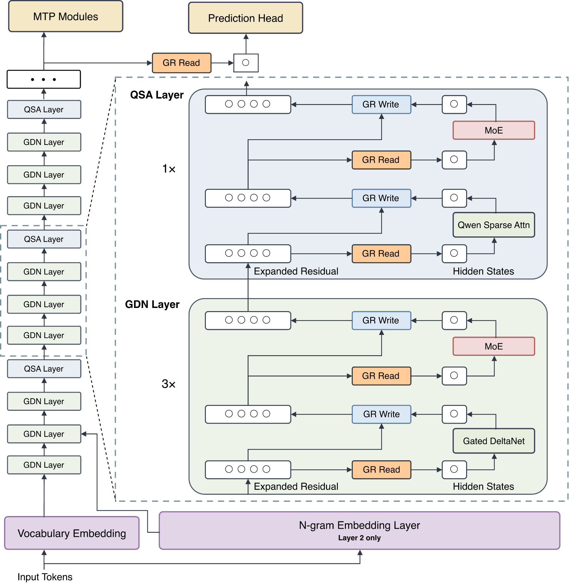

*图1　官方技术报告 Fig. 1。左侧表示逐层堆叠，右侧展开一个由三层 GDN 和一层 QSA 构成的混合模块。四个圆点表示残差分支，单个圆点表示送入计算子层的隐藏向量。N-gram 支路只在 Layer 2 注入；主预测头与 MTP 是不同的输出路径。来源：[技术报告][paper]。*

### 1.2 参数与结构口径

| 项目 | 已公开配置或模型卡口径 | 解读 |
|---|---:|---|
| 主模型参数 | 125B | 与下述额外 N-gram、MTP 参数分别报告 |
| 每 token 激活参数 | 约 6B | 模型卡口径，不能由专家数简单等比例折算 |
| 额外 N-gram 参数 | 约 51B | 大容量查表参数，不等于每 token 读取 51B 参数 |
| 额外 MTP 参数 | 约 4B | 辅助预测模块；部署是否启用取决于后端 |
| Decoder 层数 | 48 | 36 层 GDN、12 层 QSA |
| 隐藏维度 $d$ | 2560 | 计算子层宽度；GR 残差总宽度为 $4d$ |
| 词表/输出维度 | 248,320 | 模型卡标注为 padded；输入与输出权重不共享 |
| 原生上下文 | 262,144 tokens | 配置的 `max_position_embeddings` |
| 扩展上下文 | 1,000,000 tokens | 模型卡给出 YaRN 扩展方式，需显式设置 |
| GR | 4 分支，低秩瓶颈 320 | 每个 token mixer 和 MoE 均有独立 GR |
| 路由专家 | 512 个，Top-10 | 另有 1 个共享专家 |
| 单个专家中间维度 | 640 | 路由与共享专家的中间维度配置均为 640 |
| MTP | 1 层，多步训练 | 不意味着一次固定接受任意多个 token |

表中参数来自[官方模型卡][card]与[配置文件][config]。`125+51+4=180B` 仅是三个已报告分项的算术和，不应作为经过权重逐项统计的精确总量，也不据此推定视觉参数是否已经包含在某个分项中。

### 1.3 输入、主干与输出的数据关系

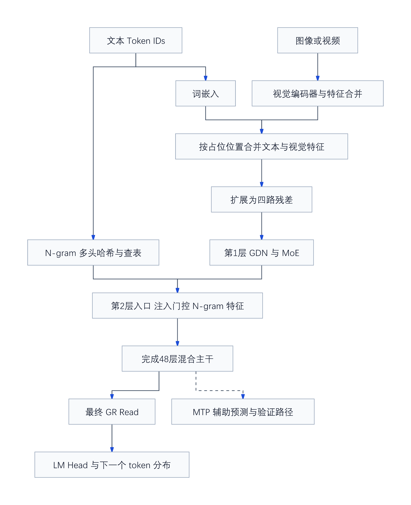

*图2　按公开实现整理的数据关系。N-gram 索引由原始 token ID 决定，查表结果在第 2 层入口结合当前残差状态注入。MTP 在此只表示辅助预测路径，不规定其后端调度与张量接口。*

<details>
<summary>图2 Mermaid 源码</summary>

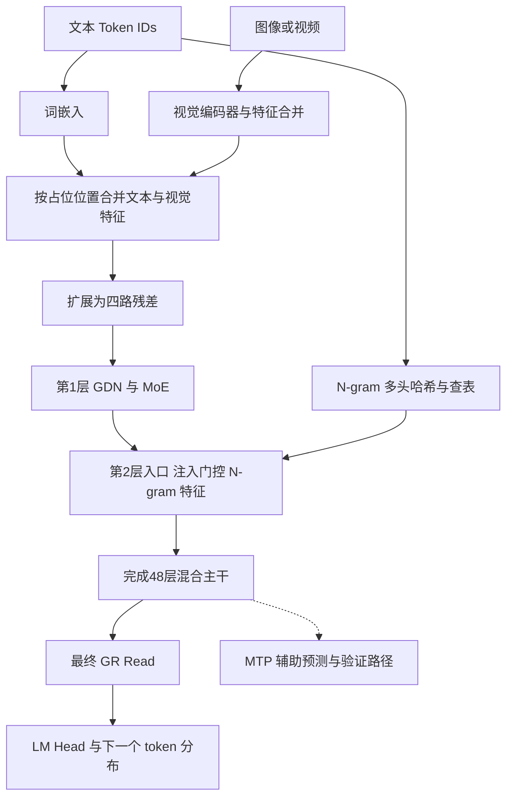

</details>

## 2 层级组织与 Decoder 执行过程

### 2.1 48 层的准确排列

以 1 为起点，QSA 位于第 $4,8,\ldots,48$ 层，其余为 GDN，即

$$
\mathrm{Decoder}=\left[(\mathrm{GDN}+\mathrm{MoE})^3\rightarrow
(\mathrm{QSA}+\mathrm{MoE})\right]^{12}.
$$

这里的“$+$”表示同一层内前后执行的两个计算子层，不表示张量直接相加；每个子层的残差更新由 GR 完成。MoE 层总数为 48，而非只出现在 QSA 层。[配置文件][config]

| 层号（1-based） | Token mixer | 前馈网络 | 特殊处理 |
|---|---|---|---|
| 1 | GDN | MoE | 提供后续 N-gram 预取的可重叠计算区间 |
| 2 | GDN | MoE | 入口执行 N-gram/PLE 注入 |
| 3 | GDN | MoE | 常规混合主干层 |
| 4 | QSA | MoE | 第一层显式稀疏注意力 |
| 5–48 | 以三 GDN、一 QSA 重复 | 每层均有 | 第 48 层为 QSA |

配置中保留了 `full_attention` 字段名；所核验 Transformers 配置代码将其转换为 `indexed_attention`。因此，不能仅凭配置字符串断言发布模型仍执行密集全注意力。[配置兼容逻辑][config-code]

### 2.2 一个 Decoder 层的计算路径

设层入口残差为 $R\in\mathbb R^{B\times T\times4\times d}$。每个计算子层读取一个 $d$ 维向量，产生 $d$ 维输出，再写回四个分支。四路残差扩宽不意味着四套 GDN 或四套 MoE 同时执行。

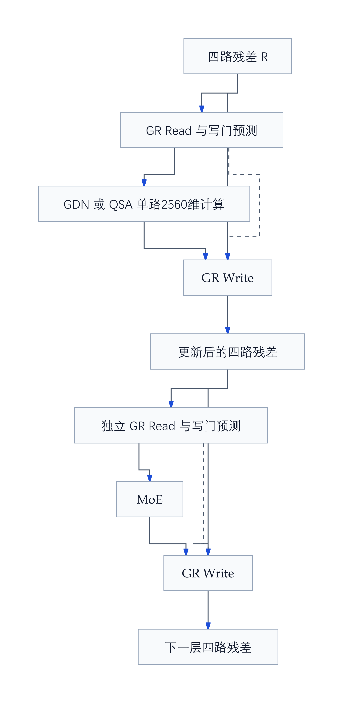

*图3　实线为子层计算，旁路保留残差；每组写门根据该子层读取前的归一化残差生成。图中省略批次、序列与通道维度。[Decoder 实现][decoder-code]*

<details>
<summary>图3 Mermaid 源码</summary>

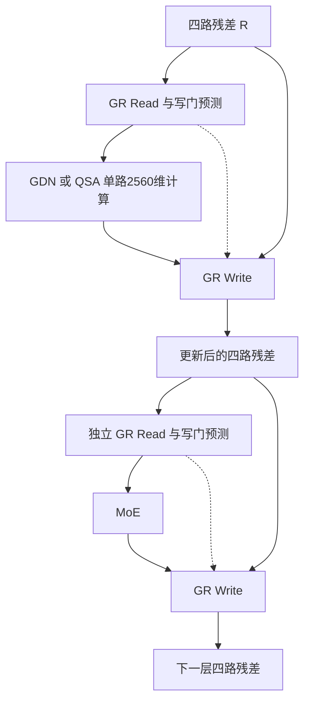

</details>

从实现角度，这个层级关系规定了数值依赖与缓存生命周期；它并不要求每个方框各对应一次 kernel 启动。融合边界应由访存量、片上资源、矩阵计算利用率与同步成本决定。

## 3 Gated DeltaNet：固定状态的内容记忆

### 3.1 投影、局部卷积与张量维度

GDN 将历史映射为递归状态，而非为每个历史 token 保存完整的可寻址 KV。公开实现先进行 QKV 投影，再执行核宽为 4 的 depthwise causal Conv1D 与 SiLU；Q、K 在递归计算中进行 L2 归一化。输出另有门控分支。[GDN 实现][gdn-code]

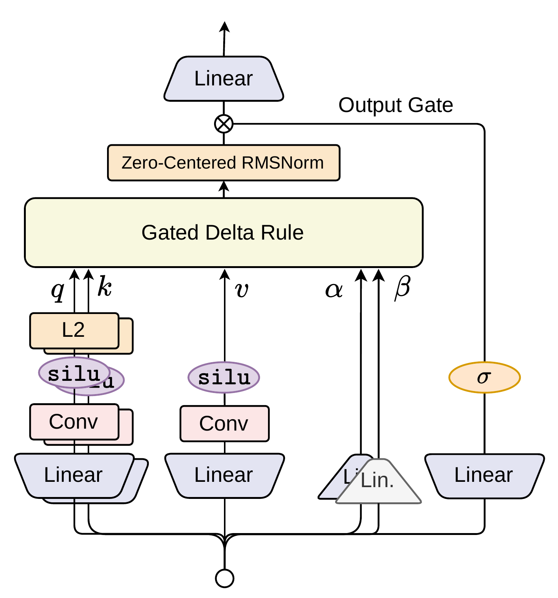

*图4　技术报告 Fig. 2。短因果卷积负责局部信息处理，$\alpha$ 与 $\beta$ 控制递归状态，输出门使用 Sigmoid。图中归一化与门控顺序应与实际实现一起解读。来源：[技术报告 §2.1.1][paper]。*

| 中间量 | 形状（忽略布局变换） | 由配置推得的宽度 |
|---|---|---:|
| 输入 $X$ | $[B,T,2560]$ | 2560 |
| 原始 Q、K | 各 $[B,T,16,128]$ | 各 2048 |
| V、输出门 Z | 各 $[B,T,48,128]$ | 各 6144 |
| 融合 QKV 投影输出 | $[B,T,10240]$ | $2048+2048+6144$ |
| 衰减、更新门 | 各 $[B,T,48]$ | 每个 V head 一个 |
| 递归状态 | $[B,48,128,128]$ | 每层、每条请求独立 |
| 输出投影输入 | $[B,T,6144]$ | 投影回 2560 |

16 组 Q/K 与 48 组 V 之间存在分组共享关系；参考代码将 Q、K 沿 head 维重复 3 次以匹配 V。高效实现可通过索引复用避免实际复制，但必须保持相同的 head 对应关系。表中形状来自[配置][config]与[GDN 代码][gdn-code]，不是通过 `hidden_size / head_num` 猜测的结果。

### 3.2 Gated Delta Rule

以下采用列向量约定，每个 head 的 $q_t,k_t\in\mathbb R^{d_k}$，$v_t\in\mathbb R^{d_v}$，状态 $S_t\in\mathbb R^{d_k\times d_v}$。技术报告给出的递归为

$$
\widetilde S_{t-1}=\alpha_t S_{t-1},\qquad
e_t=v_t-\widetilde S_{t-1}^{\mathsf T}k_t,
$$

$$
S_t=\widetilde S_{t-1}+\beta_t k_t e_t^{\mathsf T},\qquad
y_t=S_t^{\mathsf T}q_t.
$$

其中

$$
\beta_t=\sigma(W_\beta x_t),\qquad
\alpha_t=\exp\!\left[-\exp(A)\,
\operatorname{softplus}(W_\alpha x_t+b_\alpha)\right].
$$

衰减门决定历史状态保留多少，更新门决定当前预测误差写入多少。与简单地累加 $k_tv_t^{\mathsf T}$ 相比，Delta Rule 先读取当前 key 对应的已有预测，再针对差值更新。该过程在固定维度中持续改写记忆，因此无法无损地保存任意长度历史的全部细节。[技术报告式 (1)–(11)][paper]

上述为报告的数学约定。公开参考内核还包含 query 的缩放：归一化后的 query 通常乘以 $d_k^{-1/2}$；实现公式可将该因子并入 $q_t$。源码用 $g_t=\log\alpha_t$ 传递衰减量，因此不能把 $g_t$ 与 $\alpha_t$ 混用。[递归与 chunk 参考计算][gdn-ref]

输出计算可表示为

$$
o_t=W_o\!\left[\sigma(W_zx_t)\odot\operatorname{RMSNorm}(y_t)\right].
$$

对普通文本 RMSNorm，公开代码采用 $(1+w)$ 的增益参数化，并以 FP32 计算均方值。所核验的 gated RMSNorm 类则直接保存有效增益。两者均可用数学符号 $\gamma$ 表示有效增益，但迁移权重时必须遵循各自参数语义。[归一化实现][norm-code]

### 3.3 Prefill 与 Decode 的不同并行方式

将递归改写为

$$
S_t=A_tS_{t-1}+B_t,\qquad
A_t=\alpha_t(I-\beta_tk_tk_t^{\mathsf T}),\quad
B_t=\beta_tk_tv_t^{\mathsf T},
$$

便可观察到：固定输入下，状态转移是仿射映射，其组合满足结合律。这为分块计算和跨块状态传递提供了数学基础。该推导只说明可重组的依赖结构；实际高效 chunk 算法不应显式构造每个 $128\times128$ 的 $A_t$ 并执行通用矩阵乘法。

长序列 Prefill 可以把块内工作转换为更适合矩阵单元的运算，并在块间传播边界状态；单 token Decode 则围绕已有状态执行矩阵向量积、rank-one 更新与输出读取。所核验代码分别选择 chunk 和 recurrent 路径。Qwen 的 FlashQLA 为 GDN chunked prefill 提供 NVIDIA GPU 实现，其公开经验可用于理解代数重组与融合原则，但不构成 AscendC 的现成移植方案。[GDN 调用路径][gdn-code]、[FlashQLA][flashqla]

### 3.4 固定状态仍有实际容量成本

若状态使用 FP32，不考虑分片、卷积缓存及对齐，一个 GDN 层、单请求的状态容量为

$$
48\times128\times128\times4\ \mathrm{bytes}=3\ \mathrm{MiB}.
$$

36 个 GDN 层合计约 **108 MiB/请求**。这是依据配置进行的容量估算，不是实测分配量。“固定状态”指其尺寸不随历史 token 数增加，并不表示状态很小或可以整体放入一个核的 UB。分块设计应分别考察 head、key 维和 value 维的驻留与搬运成本。[状态类型与维度配置][config]

## 4 Qwen Sparse Attention：先检索微块，再计算原始 KV

### 4.1 索引器与主注意力是两套参数

QSA 的轻量索引器压缩用于检索的 key 序列，主注意力再读取被选中位置的原始 K、V。不能把索引器压缩后的 key 当成主注意力的全部 KV，也不能将两者的 head 数相互替代。

| 项目 | 轻量 Indexer | Sparse Core Attention |
|---|---:|---:|
| Q heads | 4 | 24 |
| K/KV heads | 1 个共享 K | 2 个 KV heads |
| Head dimension | 128 | 256 |
| RoPE 维度 | 64 | 64 |
| 索引 key 的压缩比 | 4 tokens/微块 | 按索引访问原始 token KV |
| 每 query 的选块预算 | 最多 512 个完整微块 | 对应 2048 tokens，另含因果尾部 |

参数依据[官方配置][config]与[技术报告 §2.1.2][paper]。

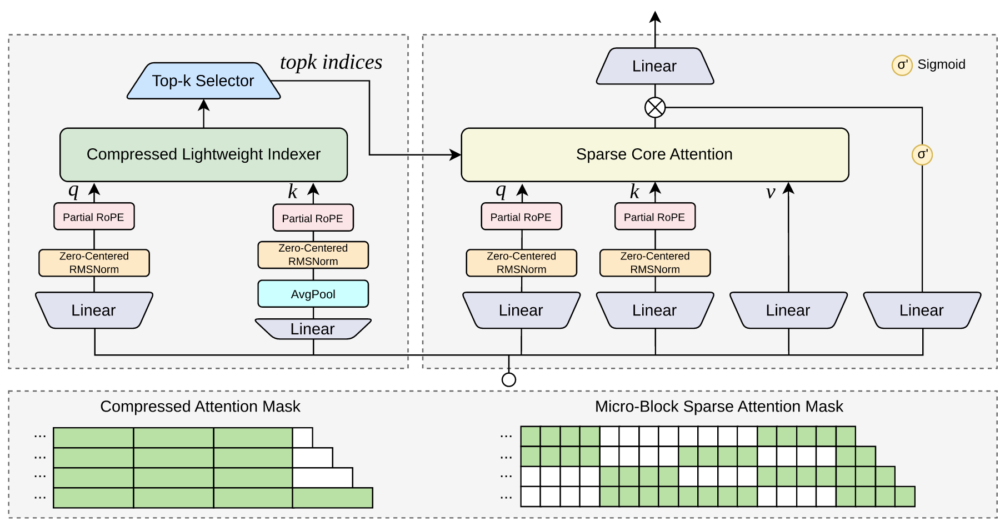

*图5　技术报告 Fig. 3。左侧索引器通过压缩 key 和 Top-k 产生微块索引；右侧主注意力使用展开后的稀疏 token 集合。下方两种掩码分别对应压缩检索空间与原始 token 空间。来源：[技术报告][paper]。*

### 4.2 压缩、位置编码与因果选块

采用从 0 开始的 token 位置。设压缩比 $r=4$，微块 $b$ 的起点 $p_b=rb$。忽略批次维，索引器计算

$$
\widehat q_i^h=\operatorname{RMSNorm}(W_Q^hx_i),\qquad
k_i^{\mathrm{idx}}=W_Kx_i,
$$

$$
\widehat k_b=\operatorname{RMSNorm}\!\left(
\frac1r\sum_{j=p_b}^{p_b+r-1}k_j^{\mathrm{idx}}\right).
$$

随后对 query 使用 token 位置 $i$，对压缩 key 使用块起点 $p_b$，执行 64 维 partial RoPE。**先池化，再归一化与旋转**可避免对不同旋转相位的 key 直接求平均。[Indexer 代码][indexer-code]

技术报告的块分数为

$$
I_{ib}=\begin{cases}
\displaystyle\sum_{h=1}^{4}\operatorname{ReLU}
\left(\langle q_i^h,\bar k_b\rangle\right),&p_b+r-1\le i,\\
-\infty,&\text{其他情形}.
\end{cases}
$$

公开 Transformers 代码还对分数乘以 $1/\sqrt{128}$；在该因子对所有候选相同且只关心排序时，它不改变 Top-k 索引，但会影响把分数作为概率 logits 使用时的数值尺度。训练 KL 损失应以训练实现的尺度为准。[技术报告式 (15)][paper]、[公开索引器][indexer-code]

令 $K=2048$、$K_B=512$，则

$$
\mathcal B_i=\operatorname{TopK}_{K_B}(I_{i,:}),\qquad
\mathcal S_i=\operatorname{Expand}(\mathcal B_i)\cup\mathcal T_i,
$$

$$
\mathcal T_i=\left\{r\left\lfloor\frac{i+1}{r}\right\rfloor,\ldots,i\right\}.
$$

仅对完全可见的微块选 Top-k，最后一个尚未完成的因果微块直接保留。当 $r=4$ 时，尾部最多有 3 个 token，因此实际集合上界为 **2051**，而非所有情形都恰好为 2048。完整微块少于 512 个时，实际选择数也相应减少。[Indexer 实现][indexer-code]

例如，query 位于 $i=9$ 时，完整微块为位置 0–3、4–7，位置 8、9 组成尾部；位置 10、11 尚不可见，不能因属于同一微块而提前访问。这个边界例子可直接作为稀疏索引的正确性测试。

### 4.3 主注意力与复杂度边界

主注意力对 $\mathcal S_i$ 内的原始 K、V 计算

$$
y_i^h=\sum_{j\in\mathcal S_i}
\frac{\exp(\langle q_i^h,k_j^{g(h)}\rangle/\sqrt{256})}
{\sum_{u\in\mathcal S_i}\exp(\langle q_i^h,k_u^{g(h)}\rangle/\sqrt{256})}
v_j^{g(h)},
$$

其中 $g(h)$ 表示 24 个 query heads 到 2 个 KV heads 的分组映射。公开实现对主 Q、K 执行 RMSNorm 与 partial RoPE，并在注意力输出之后施加 Sigmoid 门控，再投影回 2560 维。[主注意力代码][attention-code]

若把 head 数和维度视为常数，理想的完整 Prefill 代价可分解为

$$
C_{\mathrm{QSA}}\approx
O(T^2/r)_{\mathrm{Indexer}}+
C_{\mathrm{TopK}}+
O(TK)_{\mathrm{SparseCore}}.
$$

因此，固定 $r$ 并未使整个 QSA 严格变为线性复杂度。单步 Decode 的索引器仍需遍历约 $T/r$ 个块，稀疏主注意力只读取有限选中集合。主干还有 36 层 GDN，不能用单个模块的复杂度替代整个模型的成本模型。

同样，稀疏读取预算不等于全历史 KV 存储预算。假设 12 个 QSA 层保留所有历史主 KV、使用 BF16 且不分片，其容量为

$$
M_{\mathrm{KV}}=12\times T\times2_{K,V}\times2_{\mathrm{KV\ heads}}
\times256\times2\ \mathrm{bytes}.
$$

在 $T=262144$ 时为 **6 GiB/请求**，尚未计入索引器缓存、页表和对齐。该估算说明 QSA 节省主注意力访问与计算，不自动把 KV 存储限制为 2048 个 token。缓存压缩、淘汰和分层存储是额外的系统设计问题。

尤其需要区分数学稀疏性与实际执行稀疏性：所核验 Transformers 参考实现会构造稀疏位置的布尔/加性掩码，再交给 eager/SDPA 注意力；这足以表达语义，却不能作为已执行高效稀疏 kernel 的证据。[掩码与注意力调用][attention-code]

### 4.4 从密集注意力迁移到 QSA 的训练约束

官方技术报告描述了两阶段迁移：先将密集注意力分布蒸馏到块级索引器，再联合训练主干与索引器，使主干适应稀疏模式。其 KL 目标可概括为

$$
\mathcal L_{\mathrm{idx}}=
\frac1N\sum_iD_{\mathrm{KL}}\!\left(
\widehat a_{i,:}\,\Vert\,\operatorname{Softmax}(I_{i,:})\right),
$$

其中教师分布经过块内 max pooling 与归一化；稀疏训练阶段只在选中块集合内重归一化。此处 max pooling 用于教师概率聚合，前述 avg pooling 用于索引 key 压缩，两者作用不同。[技术报告 §2.1.2][paper]

## 5 Gated Residual：四路状态上的细粒度读取

### 5.1 四路残差的读写公式

设单 token 的残差为 $R\in\mathbb R^{4\times2560}$，各分支独立进行 RMSNorm：

$$
\widehat R_i=\operatorname{RMSNorm}(R_i;\gamma_i),\qquad i=1,\ldots,4.
$$

令 $u=\operatorname{vec}(\widehat R)\in\mathbb R^{10240}$，瓶颈秩 $r_g=320$。读取过程为

$$
G=\operatorname{unvec}\!\left[
\sigma\!\left(W_u\operatorname{SiLU}\left(\tfrac14W_du\right)\right)\right],
\qquad x=\tfrac14\sum_{i=1}^{4}G_i\odot\widehat R_i,
$$

$$
W_d\in\mathbb R^{320\times10240},\qquad
W_u\in\mathbb R^{10240\times320}.
$$

写门与更新为

$$
s=2\sigma(\tfrac14W_wu)\in\mathbb R^4,
\qquad R'_i=R_i+s_i\,\mathcal F(x),
\quad W_w\in\mathbb R^{4\times10240}.
$$

读门 $G$ 是“每分支、每通道”一个系数；写门 $s$ 是“每分支”一个标量，范围为 $(0,2)$。两者不是同一个门，也不要求分支系数之和为 1。公开实现与上述公式一致；每个 token mixer 和 MoE 有独立参数。[GR 实现][gr-code]

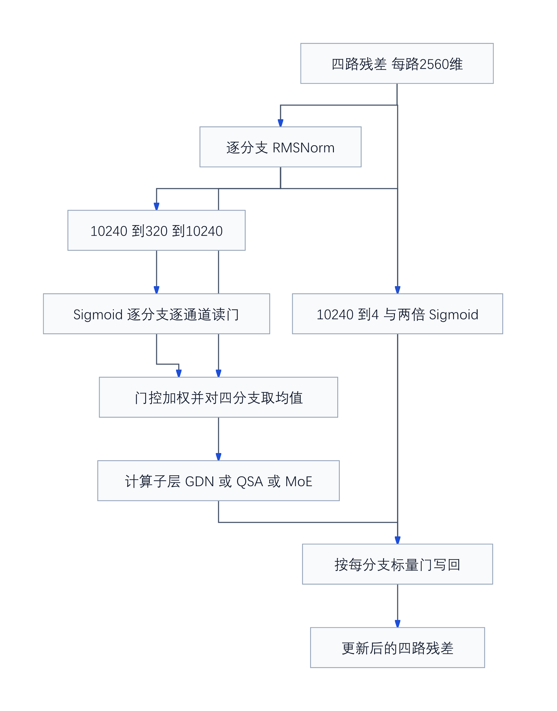

*图6　归一化残差同时用于生成读门与写门；原始残差通过旁路保留。GR 没有额外的分支间 $4\times4$ 残差混合矩阵 $H_{res}$。[技术报告 §2.2][paper]*

<details>
<summary>图6 Mermaid 源码</summary>

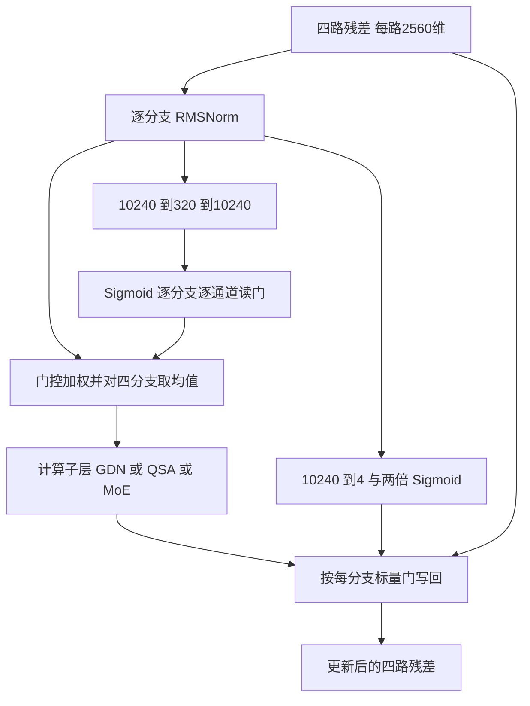

</details>

### 5.2 访存与融合的工程含义

若残差使用 BF16，每个 token 的四路状态占 $4\times2560\times2=20480$ bytes，即 20 KiB；单路则为 5 KiB。这是活跃残差表示的大小，不是像 KV 一样为每个历史位置长期累积的 Decode 缓存。Prefill 的大 $BT$ 会使中间激活与访存显著增加。

GR 优化需要同时考虑低秩投影和状态遍历。为降低全局内存流量，可让归一化结果在多个门控计算之间复用，并将最后的门控、分支归约和写回相邻融合；低秩 GEMM 是否纳入同一内核，仍需检查 Cube/Vector 协同、片上容量与并行度。官方报告称其实现将 Read 与 Write 分别融合，并讨论 FP8 残差存储；这不能推导出任何昇腾设备已经具有同样的精度与性能表现。[技术报告“GR Inference Efficiency”][paper]

四个分支的功能由训练形成。将某一分支固定解释为“语义”“位置”或“长期记忆”属于缺乏权重分析依据的命名。汇报时宜说明动态读写机制，而不赋予分支预设职责。

## 6 MoE：稀疏专家与共享路径

### 6.1 路由、专家与合并

每个 token 由 512 维 router 产生专家概率，选择 Top-10 路由专家，并同时执行共享专家。公开实现对选中概率进行归一化；共享专家输出另乘以独立 Sigmoid gate。[MoE 与 Router 代码][moe-code]、[配置默认值][config-code]

$$
p=\operatorname{Softmax}(W_rx),\qquad
\mathcal E=\operatorname{TopK}_{10}(p),\qquad
\widetilde p_e=\frac{p_e}{\sum_{j\in\mathcal E}p_j}.
$$

单个专家使用 SwiGLU：

$$
f_e(x)=W_{e,\mathrm{down}}
\left[\operatorname{SiLU}(W_{e,\mathrm{gate}}x)
\odot(W_{e,\mathrm{up}}x)\right].
$$

整体输出为

$$
y=\sum_{e\in\mathcal E}\widetilde p_ef_e(x)
+\sigma(w_s^{\mathsf T}x)f_s(x).
$$

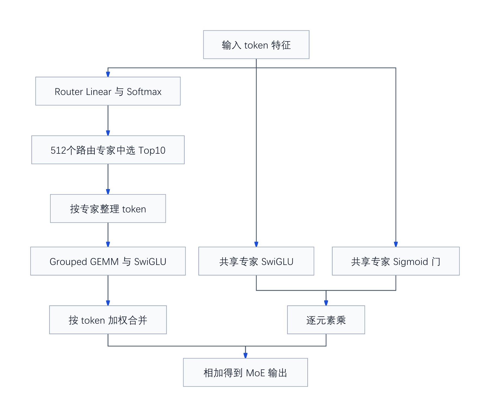

*图7　路由专家按 token 动态选择；共享专家始终计算，其贡献由独立门控调节。Dispatch/Combine 表示数据组织，采用专家并行时才进一步涉及跨设备通信。*

<details>
<summary>图7 Mermaid 源码</summary>

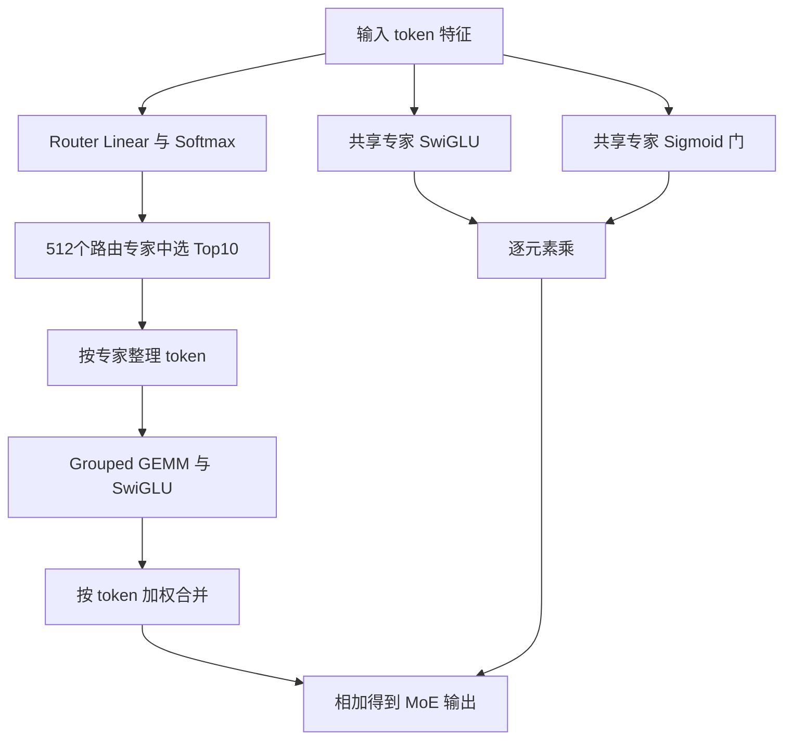

</details>

### 6.2 参数稀疏性与执行成本

忽略偏置，一个中间维度 640 的专家约有

$$
P_{\mathrm{expert}}=3\times2560\times640=4{,}915{,}200
$$

个矩阵参数。单层 512 个路由专家加 1 个共享专家约为 2.52B，48 层约为 121.03B；每 token 的 11 个专家矩阵跨 48 层约为 2.60B。以上是按矩阵形状推算的近似量，不包含 router、GR、注意力、嵌入或预测头，因此只能解释稀疏参数分布，不能代替模型卡的 125B/6B 统计口径。

稀疏专家激活并不保证所有批次都能高效计算。小批次 Decode 中，某些专家只有很少 token，Grouped GEMM 可能受到小矩阵利用率和权重读取限制；大批次中则可能受到专家负载偏斜或通信约束。“代码专家”“数学专家”等称呼仅是教学比喻，除非有专门分析，否则不应作为每个专家已获证实的固定语义。

## 7 N-gram Embedding：局部上下文查表与分层存储

### 7.1 多头哈希与表容量

模型使用以当前 token 结尾的 bigram 和 trigram，多头哈希产生表索引。配置的 `ngram_size=3`、`heads_per_ngram=8` 对应两种阶数各 8 个 head，总计 16 个查表 head；`ple_embed_dim=2560` 对应每 head 160 维。[N-gram 实现][ngram-code]

可用下式概括索引语义：

$$
z_t^{(n,h)}=\operatorname{Hash}_{n,h}(u_{t-n+1},\ldots,u_t)
\bmod V_{n,h},\qquad
e_t=\operatorname{Concat}_{n,h}E_{n,h}[z_t^{(n,h)}].
$$

这里的 `Hash` 是概念记号，真实实现使用固定乘子、按位异或、各 head 的素数表容量及偏移，并处理 EOS 与序列边界，不能替换成任意语言运行时的字符串哈希。20,000,000 是每 head 表容量的基础尺度，不等于整个模块只含一个 2000 万行、2560 维的大表。按基础尺度估算，$16\times20{,}000{,}000\times160\approx51.2$B 参数，与官方约 51B 的口径相符；实际还受素数与 padding 影响。[配置][config]、[哈希与表布局代码][ngram-code]

### 7.2 Contextual gating 与注入细节

第 2 层入口的 PLE 模块将查表结果映射成共享 value 与四分支 key，并由当前四路残差产生 query。对分支 $i$，公开实现等价于

$$
k_{t,i}=\operatorname{RMSNorm}((W_ke_t)_i),\qquad
q_{t,i}=\operatorname{RMSNorm}(R_{t,i}),\qquad v_t=W_ve_t,
$$

$$
a_{t,i}=\langle q_{t,i},k_{t,i}\rangle/\sqrt d,\quad
\psi(a)=\operatorname{sign}(a)\sqrt{\max(|a|,10^{-6})},
$$

$$
u_{t,i}=\sigma(\psi(a_{t,i}))v_t.
$$

再对门控 value 做分组归一化、核宽 4、膨胀率 3 的 depthwise causal Conv1D 和 SiLU，将局部卷积分支与 $u$ 相加，形成注入量 $\Delta R$，最后执行 $R\leftarrow R+\Delta R$。[PLE 实现][ple-code]

这些投影与卷积使 N-gram 模块仍有计算开销。所谓“低计算成本”主要指增加查表容量时，每 token 不需要遍历新增的全部表参数；它不意味着该模块只有一次 Gather，也不意味着查表内容是直接可读的知识条目。

### 7.3 异步预取需要满足的时间条件

查表地址依赖原始 token ID，因而可在早期提前计算。若大表放置于 host memory，需尽量让其读取和传输覆盖在前序层计算之内。公开 vLLM 路径支持 device 或 pinned-host 表存储，并提供 `start_prefetch`；具体调度属于服务框架实现。[vLLM N-gram 模块][vllm-ngram]

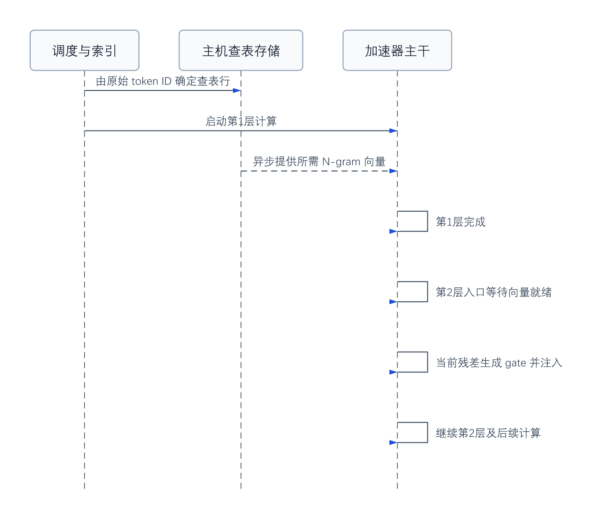

*图8　时序示意，表示可利用的重叠窗口；不表示传输一定能被完全隐藏。地址计算可以提前，contextual gating 仍需等待当前层的残差特征。*

<details>
<summary>图8 Mermaid 源码</summary>

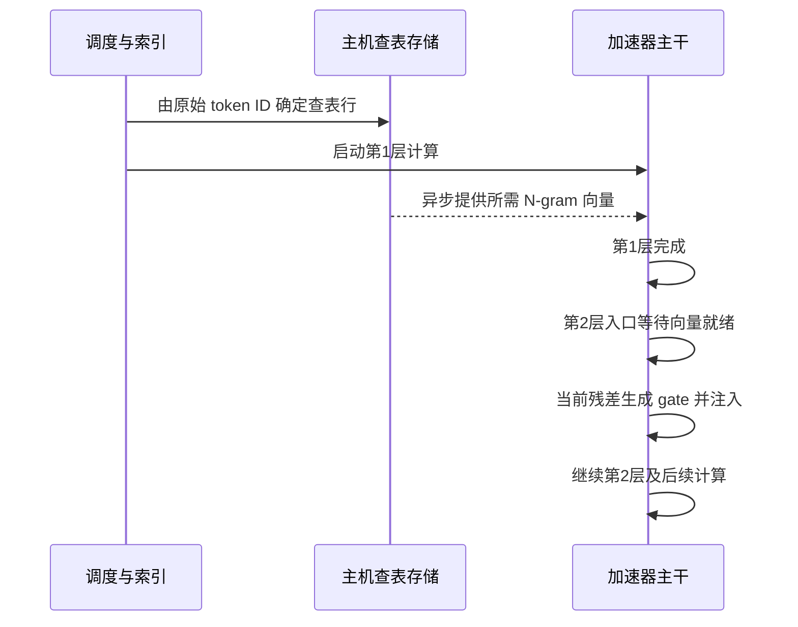

</details>

以全部表参数为 BF16 估算，51B 参数约需 102 GB，即约 95 GiB 存储；这是权重容量，不是单 token 传输量。若每 token 只取 16 个 160 维向量，其裸数据约为 5120 bytes/BF16 token，未计重复读取、传输粒度、元数据、缓存与量化。

理想重叠下，可将额外关键路径开销近似写为

$$
T_{\mathrm{extra}}\approx
\max(0,T_{\mathrm{lookup+transfer}}-T_{\mathrm{overlap}})
+T_{\mathrm{gate+inject}}.
$$

这是调度分析模型。host 内存随机访问、实际链路带宽、batch 大小与异步流安排都可能破坏理想重叠，不能仅因采用预取就宣称“零开销”。

## 8 视觉输入、语言输出与 MTP

### 8.1 Vision Encoder 的实际层级

| 项目 | 配置值 | 模块含义 |
|---|---:|---|
| Patch size | $16\times16$ | 空间块尺寸 |
| Temporal patch size | 2 | 时序块尺寸；单图的帧处理由预处理器决定 |
| 输入通道 | 3 | RGB 通道 |
| Vision Transformer 层数 | 27 | 与 48 层语言 Decoder 独立 |
| Vision hidden size | 1152 | 视觉 token 通道数 |
| Attention heads | 16 | 每 head 维度由配置推得为 72 |
| MLP intermediate size | 4304 | 使用 `gelu_pytorch_tanh` 激活 |
| Spatial merge size | 2 | 相邻 $2\times2$ 空间 token 合并 |
| 输出维度 | 2560 | 对齐语言主干输入宽度 |

参数来自[视觉配置][config]。公开代码使用 kernel 与 stride 均为 $(2,16,16)$ 的 Conv3D 实现 patch embedding。每个视觉 block 包含 LayerNorm、self-attention 与残差，再接 LayerNorm、MLP 与残差。[视觉模块实现][vision-code]

视觉合并不能仅写作一条 $1152\rightarrow2560$ 线性变换。该版本先对局部特征归一化并将 $2\times2$ 特征拼接为 4608 维，再通过 $4608\rightarrow4608$、GELU、$4608\rightarrow2560$ 的两层投影。输出根据图像/视频占位位置写入语言输入。[Patch Merger][merger-code]

```text
图像/视频预处理
  → Conv3D Patch Embedding：3×2×16×16 → 1152
  → 27 × [LayerNorm → Attention → Residual → LayerNorm → MLP → Residual]
  → 空间2×2合并：4×1152 = 4608
  → Linear(4608,4608) → GELU → Linear(4608,2560)
  → 写入多模态占位位置 → 语言主干
```

### 8.2 最终 GR Read 与 LM Head

语言主干最后的四路残差通过独立 GR Read 归并为 2560 维表示，再通过 LM Head 输出 248,320 维 logits：

$$
\ell_t=W_{\mathrm{lm}}h_t,\qquad
p(u_{t+1}\mid u_{\le t})=\operatorname{Softmax}(\ell_t).
$$

temperature、Top-k、Top-p 属于生成策略；它们与 MoE 的专家 Top-k、QSA 的微块 Top-k 是不同对象。服务中只为必要位置计算 logits，可以减少大词表投影工作，但这是后端执行策略。[语言主干与最终 mixer][text-model-code]

### 8.3 MTP 与推测解码

模型卡说明 MTP 为一层、多步训练，技术报告说明其多步预测可复用 QSA Top-k 索引。这种复用针对辅助预测步骤，不应解释为主干全部 QSA 层共用同一索引。[模型卡][card]、[技术报告 QSA Implementation Details][paper]

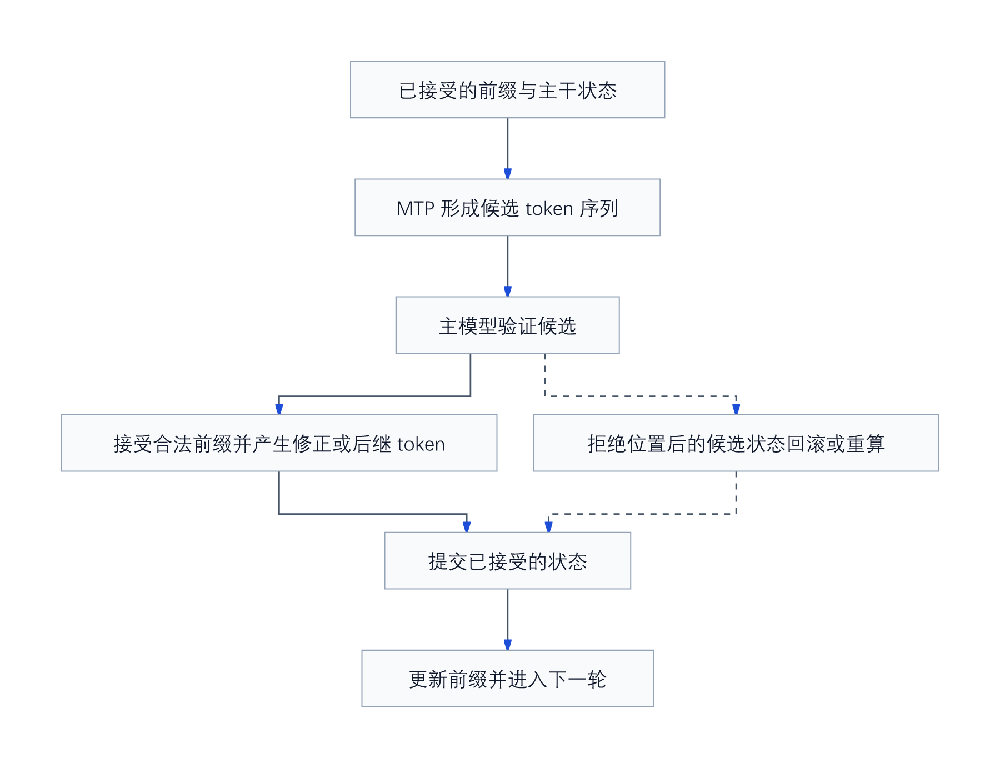

*图9　推测解码的概念执行流程。候选长度、接受规则与状态回滚由服务后端实现，不能仅由模型卡的一层 MTP 推出固定加速倍数。*

<details>
<summary>图9 Mermaid 源码</summary>

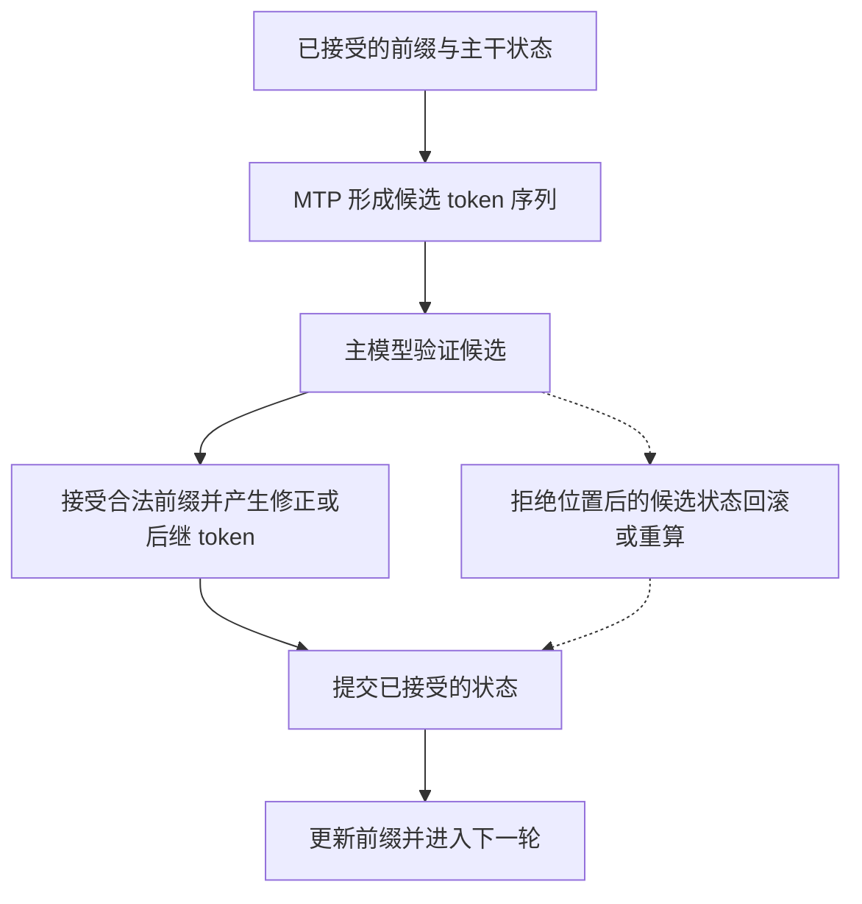

</details>

若采用采样解码，保持目标模型分布需要相应的接受/拒绝算法，不能把“候选与主模型 argmax 相同”作为一般接受规则。若候选最终接受 $a$ 个 token，一轮耗时可粗略写为

$$
\mathrm{tokens/s}\approx
\frac{\mathbb E[\text{一轮实际提交的 token 数}]}
{T_{\mathrm{draft}}+T_{\mathrm{verify}}+T_{\mathrm{schedule+state}}}.
$$

对含 GDN 的模型，验证还涉及递归状态的提交与恢复；只验证 token 对错而不验证状态，会在后续生成中引入错误。所核验 Transformers 通用模型类将 `mtp.*` 列入可忽略的额外权重，其主体代码不足以证明完整 MTP 服务路径已经启用；部署应另核实所选后端的实现。[模型加载实现][load-code]

## 9 训练优化与性能证据的解释

Muon 是训练优化器，其主要工作是对矩阵动量执行近似正交化；它不属于推理前向图的 token mixer。官方报告将其用于适合线性映射的矩阵权重，将输入/查表 embedding、LM head、router 与 GR 低秩投影等保留给 AdamW，并在正交化前拆分部分融合参数。该选择提示：服务时可融合的矩阵，不一定适合在训练优化时作为同一个矩阵处理。[技术报告 §3.1][paper]

| 报告中的结果 | 比较对象与条件 | 可支持的结论与限制 |
|---|---|---|
| 训练 FLOPs 约为前代的 $1/9$ | 125B-A6B 对比前代 397B-A17B，同时训练 token 量约为其 $1/3$ | 包含激活规模与数据预算变化，不能全部归因于某个新算子 |
| QSA Prefill 加速 $7.6\times$ | 1M 上下文；chunked prefill，chunk=16K，batch=1；基线为 FlashInfer paged GQA | attention 模块/kernel 级结果，包含 indexer 与 sparse core，非整模型加速 |
| QSA Decode 加速 $4.9\times$ | 1M 上下文；batch=4，`next_n=4`，含三步 MTP | 不可直接外推为任意 batch、短序列或无 MTP 的收益 |
| FlashQLA 前向约 $2$–$3\times$、反向约 $2\times$ | NVIDIA GPU，多组测试，相对 FLA Triton kernel | 说明 GDN 代数重组与内核优化空间，不是昇腾数据 |

来源：[技术报告摘要与 Fig. 6][paper]、[FlashQLA 仓库及测试说明][flashqla]。以上为来源报告的结果，本文未独立复现；具体 GPU、软件版本和各测试 shape 应随原始 benchmark 一并引用，不能把不同表格的条件拼接为统一测试环境。

由 Amdahl 定律，若某模块占原执行时间比例 $p$，其自身加速 $s$ 倍，忽略新增开销，端到端最大收益为

$$
S_{\mathrm{e2e}}=\frac1{(1-p)+p/s}.
$$

例如 $p=0.4,s=5$ 时，整模型最多约 $1.47\times$，而不是 $5\times$。这是理论示例，所用 $p$ 并非该模型实测占比。

## 10 从模块到算子：AscendC 的实现与优化启示

### 10.1 算子映射与执行资源

下表中的算子名称表示计算类别，不宣称某个版本的 CANN 已提供同名、同语义的融合 API。Cube/Vector 选择是候选实现方向，应根据具体芯片、数据类型和矩阵规模决定。

| 模块 | 必须保持的计算语义 | 主要计算/数据操作 | 昇腾实现关注点 |
|---|---|---|---|
| 词嵌入 | token ID 到向量 | Gather/Embedding | 随机访问、ID 边界、批量搬运 |
| GDN 投影与卷积 | Q/K/V/Z 与门控；因果局部上下文 | GEMM、depthwise Conv1D、SiLU | 大矩阵利用 Cube；短卷积和激活可研究 Vector 融合 |
| GDN 状态核心 | 衰减、误差修正、rank-one 更新与读取 | GEMV/矩阵分块、Mul/Add/Reduce | head 分工、状态 tiling、跨 token 依赖、数值精度 |
| QSA Indexer | 压缩后位置编码与块因果 Top-k | AvgPool、RMSNorm、RoPE、打分、ReLU/Reduce、Top-k | 不物化全量分数；分段选择；维护块与尾部 |
| QSA 主注意力 | 对选中原始 KV 做缩放 Softmax Attention | 稀疏索引访存、GQA、online Softmax、输出 GEMM | 页式 KV 到微块映射、同 KV head 复用、因果掩码 |
| GR | 分组归一化、逐通道读门、标量写门 | 小/低秩 GEMM、SiLU/Sigmoid、Mul/Reduce/Add | 减少四路残差的重复 GM 往返，控制中间激活 |
| MoE | Top-10 权重与共享 gate | Router、Top-k、Dispatch、Grouped GEMM、SwiGLU、Combine | token 排序、专家负载、矩阵尺寸分桶、通信重叠 |
| N-gram/PLE | 多头哈希、查表、上下文门控与膨胀卷积 | 整数运算、Gather、投影、Norm、Sigmoid、Conv | host 预取、重复行缓存、链路与计算流水 |
| Vision Encoder | 视觉 patch、变长 attention、2×2 merge | Conv3D、LayerNorm、Attention、GELU、GEMM | 变长分组、空间布局与精度一致性 |
| LM/MTP | logits 与辅助候选验证 | 大词表 GEMM、采样、验证与状态维护 | 必要位置投影、验证批处理、GDN 状态回滚 |

模块语义依据前文所引[公开模型实现][impl]；昇腾优化列为本文分析。AscendC 的 `TPipe`、`TQue`、`TBuf` 提供片上资源与流水组织机制；官方文档强调，队列深度与 double buffering 是不同概念，双缓冲应依据实际 buffer 分配与数据依赖设计。[TQue 官方说明][ascend-tque]、[流水优化说明][ascend-pipeline]

### 10.2 GDN：先选择驻留粒度，再确定融合范围

Decode 可优先按请求与 V head 分配工作，在核内对状态矩阵进一步分块。即使单 head 状态只有 64 KiB/FP32，实际工作集还包含 Q/K/V、临时误差、输出、卷积状态与搬运缓冲，因此是否可驻留 UB 必须通过资源预算确定；也不能将多核并行直接应用于同一请求相邻 token，忽略递归依赖。

Prefill 则应围绕 chunk 边界状态设计，将矩阵密集部分与逐元素部分分工，评估 Cube/Vector 交接代价。融合目标应是减少真实瓶颈上的数据往返；过大的单内核可能增加片上占用并降低并行度。完整移植应同时校验每个 chunk 的输出与最终状态，而非只比较最终 logits。

### 10.3 QSA：优化索引链路与稀疏访存的总成本

QSA 的预算单位为 4-token 微块，服务后端的物理 KV page/block 则可能具有另一种粒度。二者不能直接等同；内核需要将微块逻辑索引映射到缓存页与页内偏移。选中块可以按物理访问顺序整理以改善合并访存，但必须保持 key/value 配对和掩码语义，并评估重排本身的成本。

Indexer 可采用分块打分与局部候选合并，避免在 GM 中保存完整 $T\times(T/r)$ 分数矩阵。Top-k 的正确性应覆盖分数相等、候选不足、序列 padding 和不完整尾块；若并列分数的选择不同，应区分“排序结果允许不同”与“下游输出必须一致”的验证要求。

主注意力可研究把 KV gather 与 attention 计算衔接，避免先写出大规模连续 KV 副本；Softmax 应采用数值稳定的分块归约。即使在被选集合上精确执行 Softmax，QSA 相对于全上下文密集注意力仍是受训练支持的稀疏替代，不能称为原密集 Attention 的无误差重排。

### 10.4 GR：按访存收益评估读写融合

GR Read 至少涉及分支归一化、低秩门控和分支归约，Write 涉及输出缩放与四路状态更新。可先建立模块时间与 bytes moved，再比较“低秩 GEMM 单独执行、末端向量操作融合”和更大融合边界的效果。保持语义时，应保留 $1/4$ 缩放、写门的 $2\sigma$、分支独立归一化和 FP32 reduction 等数值要求。

FP8 残差存储可以作为后续研究方向，但必须验证目标硬件支持、量化缩放策略、累加精度与长期生成误差；不能以官方 GPU 实验替代本地验证。

### 10.5 MoE 与 N-gram：调度成本可能高于算术成本

专家并行场景下，Dispatch/Combine 会涉及跨设备数据交换；单卡实现则可能只包含本地 gather/scatter。优化时应分别测量路由、专家矩阵计算、数据重排和通信，避免把 All-to-All 当作每个 MoE 配置必然执行的算子。Grouped GEMM 应按各专家接收的 token 数选择任务粒度，结合真实路由分布判断负载均衡。

N-gram 表的主要约束可能来自 host 随机读取与链路延迟。加速器内优化 Hash 或 Gather 只有在该部分确实占据关键路径时才会产生可见收益。可研究批内重复行去重、热点行缓存、合并小传输和提前预取，并把请求边界、EOS 与多模态占位 token 的处理纳入一致性验证。

### 10.6 用可测指标决定优先级

可先用 Roofline 形式进行粗略判断：

$$
T_{\mathrm{kernel}}\gtrsim
\max\left(\frac{F}{P_{\mathrm{effective}}},
\frac{D}{BW_{\mathrm{effective}}}\right),
$$

其中 $F$ 为浮点运算量，$D$ 为实际搬运字节量。对 QSA、MoE 和 host 查表，还要额外考虑索引、同步、通信及调度延迟，不能只靠峰值 FLOPs 判断快慢。

| 验证层级 | 建议记录的指标 | 能回答的问题 |
|---|---|---|
| 数值正确性 | 输出误差、状态误差、索引合法性、越界与因果性 | 是否保持模型语义 |
| Kernel | 延迟、有效带宽、矩阵利用率、核间耗时分布 | 是否改善目标计算或搬运 |
| 模块 | Indexer+Top-k+稀疏核心总延迟；完整 GR/MoE 延迟 | 是否只是把成本转移到相邻算子 |
| Prefill | TTFT、prefill tokens/s、峰值内存 | 长输入处理是否受益 |
| Decode | token 间延迟、输出吞吐、batch 与上下文长度 | 常用服务负载下是否受益 |
| MTP 与服务 | 实际接受长度、验证耗时、P50/P99、提交状态 | 理论并行是否转化为端到端收益 |

建议以短/长上下文、小/大 batch、纯文本/视觉输入和 MTP 开关组成代表性负载，先获取真实耗时占比，再确定优化排序。GDN、QSA、GR 的架构新颖性可以决定研究切入点，但不能代替 profiling 证明其为最耗时模块。

## 11 讨论与结论

Qwen3.8-Flash-Next 的结构可以概括为三种互补的容量：GDN 用固定状态承载压缩历史，QSA 保留对选中原始 token 的直接访问，N-gram 表以局部上下文确定的地址扩展参数容量；MoE 则在较低单 token 激活规模下提供大量前馈参数。GR 为这些计算结果提供跨层、跨通道的动态读取与写回通路。它们相互补充，但并不分别保证无损记忆、恒定总内存或固定的推理加速。

从算子研究出发，最有价值的分析单位是完整的数据依赖链：GDN 的状态读写、QSA 的索引与稀疏访问、GR 的宽残差流量、MoE 的重排与矩阵执行，以及 N-gram 的跨存储层预取。AscendC 的贡献应落实到可验证的内存流量减少、硬件利用率提高和关键路径缩短，并同时保持数学语义与状态一致性。

本报告已核验公开配置、关键公式、模块顺序与可见实现差异；尚未开展权重逐项统计、模型推理复现或昇腾性能测试。上述容量估算与优化路线均保留各自假设，可作为后续移植、算子开发和汇报讨论的起点。

## 参考文献

1. Qwen Team. **Qwen3.8-Flash-Next 官方模型卡**. [Hugging Face，固定模型版本][card]。用于核对参数口径、上下文长度、MTP 与整体结构。
2. Qwen Team. **Qwen3.8-Flash-Next config.json**. [固定版本配置][config]。用于核对文本/视觉维度、层型、专家、索引器与 N-gram 参数。
3. Qwen Team. **On the Design of Qwen3.8-Next Architecture: Evaluation, Efficiency, and Training Stability**. arXiv:2608.30320v1, 2026-08-31. [全文 HTML][paper]；[摘要与版本页](https://arxiv.org/abs/2608.30320v1)。公式与官方原图的主要来源。
4. QwenLM. **Qwen3.8-Flash-Next 官方仓库**. [GitHub][repo]。仓库提供架构说明及 `tech_report.pdf`；不是完整内部训练系统源码。
5. Hugging Face Transformers contributors. **Qwen4Exp 模型实现**. [modeling_qwen4_exp.py][impl]；[configuration_qwen4_exp.py][config-code]。固定 commit：`5f6629d89508568afaadf5d60cace11ec0edebbc`。本文模块实现分析所用代码快照。
6. QwenLM. **FlashQLA: high-performance linear attention kernel library built on TileLang**. [GitHub][flashqla]。用于核对 GDN chunked-prefill 接口、优化对象及 GPU 性能口径。
7. vLLM contributors. **Qwen4Exp N-gram embeddings with device and pinned-host storage**. [源码][vllm-ngram]。
8. Huawei Ascend. **Ascend C TQue 接口说明**. [CANN 8.5.0 文档][ascend-tque]。用于核对队列与双缓冲概念。
9. Huawei Ascend. **Ascend C Pipeline Optimization**. [CANN 8.5.0 文档][ascend-pipeline]。用于核对 `TPipe` 模式下 buffer 分配与 double buffering。

[paper]: https://arxiv.org/html/2608.30320v1
[repo]: https://github.com/QwenLM/Qwen3.8-Flash-Next
[card]: https://huggingface.co/Qwen/Qwen3.8-Flash-Next/blob/de4b8e4d43b917e7706784d8bb445c9af86a3540/README.md
[config]: https://huggingface.co/Qwen/Qwen3.8-Flash-Next/blob/de4b8e4d43b917e7706784d8bb445c9af86a3540/config.json
[hf-files]: https://huggingface.co/Qwen/Qwen3.8-Flash-Next/tree/de4b8e4d43b917e7706784d8bb445c9af86a3540
[impl]: https://github.com/huggingface/transformers/blob/5f6629d89508568afaadf5d60cace11ec0edebbc/src/transformers/models/qwen4_exp/modeling_qwen4_exp.py
[config-code]: https://github.com/huggingface/transformers/blob/5f6629d89508568afaadf5d60cace11ec0edebbc/src/transformers/models/qwen4_exp/configuration_qwen4_exp.py#L162
[gdn-code]: https://github.com/huggingface/transformers/blob/5f6629d89508568afaadf5d60cace11ec0edebbc/src/transformers/models/qwen4_exp/modeling_qwen4_exp.py#L456
[gdn-ref]: https://github.com/huggingface/transformers/blob/5f6629d89508568afaadf5d60cace11ec0edebbc/src/transformers/models/qwen4_exp/modeling_qwen4_exp.py#L254
[norm-code]: https://github.com/huggingface/transformers/blob/5f6629d89508568afaadf5d60cace11ec0edebbc/src/transformers/models/qwen4_exp/modeling_qwen4_exp.py#L143
[indexer-code]: https://github.com/huggingface/transformers/blob/5f6629d89508568afaadf5d60cace11ec0edebbc/src/transformers/models/qwen4_exp/modeling_qwen4_exp.py#L665
[attention-code]: https://github.com/huggingface/transformers/blob/5f6629d89508568afaadf5d60cace11ec0edebbc/src/transformers/models/qwen4_exp/modeling_qwen4_exp.py#L811
[moe-code]: https://github.com/huggingface/transformers/blob/5f6629d89508568afaadf5d60cace11ec0edebbc/src/transformers/models/qwen4_exp/modeling_qwen4_exp.py#L952
[gr-code]: https://github.com/huggingface/transformers/blob/5f6629d89508568afaadf5d60cace11ec0edebbc/src/transformers/models/qwen4_exp/modeling_qwen4_exp.py#L995
[ngram-code]: https://github.com/huggingface/transformers/blob/5f6629d89508568afaadf5d60cace11ec0edebbc/src/transformers/models/qwen4_exp/modeling_qwen4_exp.py#L1072
[ple-code]: https://github.com/huggingface/transformers/blob/5f6629d89508568afaadf5d60cace11ec0edebbc/src/transformers/models/qwen4_exp/modeling_qwen4_exp.py#L1177
[decoder-code]: https://github.com/huggingface/transformers/blob/5f6629d89508568afaadf5d60cace11ec0edebbc/src/transformers/models/qwen4_exp/modeling_qwen4_exp.py#L1252
[load-code]: https://github.com/huggingface/transformers/blob/5f6629d89508568afaadf5d60cace11ec0edebbc/src/transformers/models/qwen4_exp/modeling_qwen4_exp.py#L1320
[text-model-code]: https://github.com/huggingface/transformers/blob/5f6629d89508568afaadf5d60cace11ec0edebbc/src/transformers/models/qwen4_exp/modeling_qwen4_exp.py#L1371
[vision-code]: https://github.com/huggingface/transformers/blob/5f6629d89508568afaadf5d60cace11ec0edebbc/src/transformers/models/qwen4_exp/modeling_qwen4_exp.py#L1759
[merger-code]: https://github.com/huggingface/transformers/blob/5f6629d89508568afaadf5d60cace11ec0edebbc/src/transformers/models/qwen4_exp/modeling_qwen4_exp.py#L1779
[flashqla]: https://github.com/QwenLM/FlashQLA
[vllm-ngram]: https://github.com/vllm-project/vllm/blob/main/vllm/models/qwen4_exp/nvidia/ngram_embedding.py
[ascend-tque]: https://www.hiascend.com/document/detail/en/CANNCommunityEdition/850/API/ascendcopapi/atlasascendc_api_07_0137.html
[ascend-pipeline]: https://www.hiascend.com/doc_center/source/en/CANNCommunityEdition/850/opdevg/Ascendcopdevg/atlas_ascendc_10_00019.html
