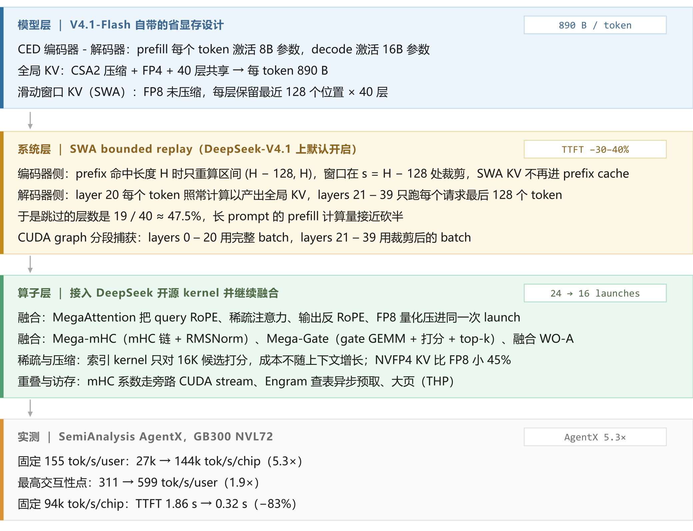
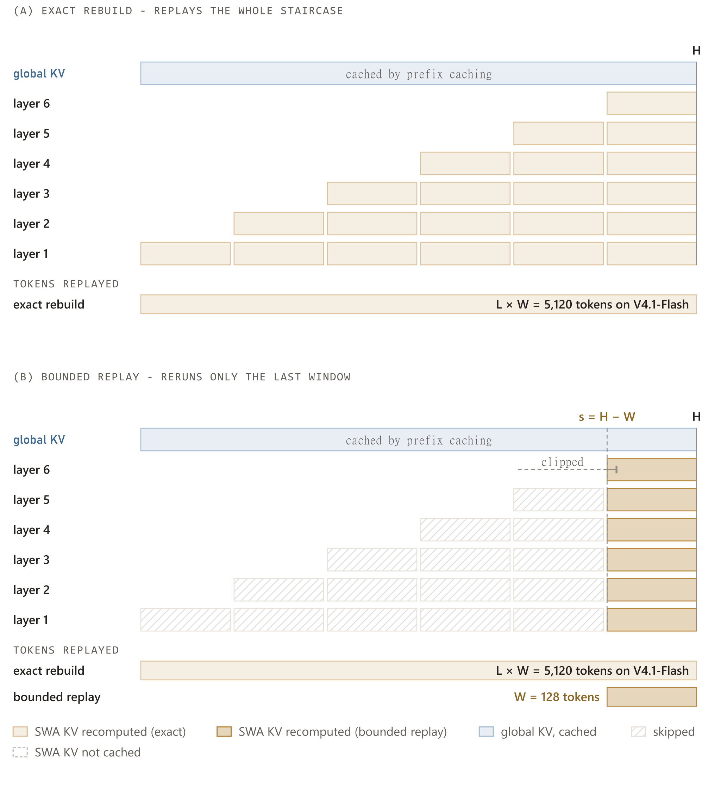
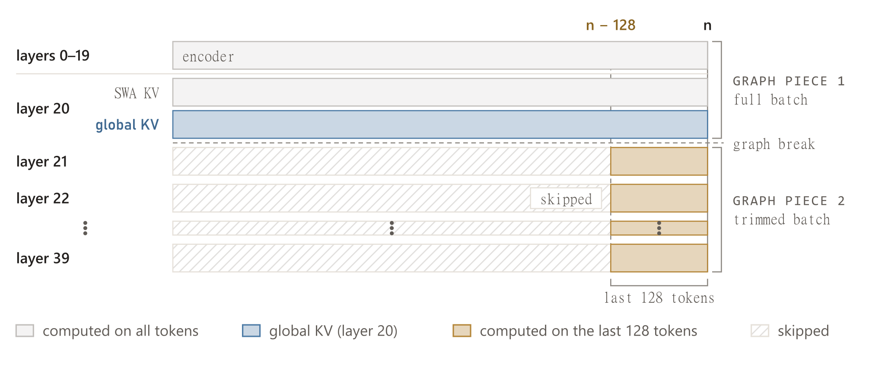
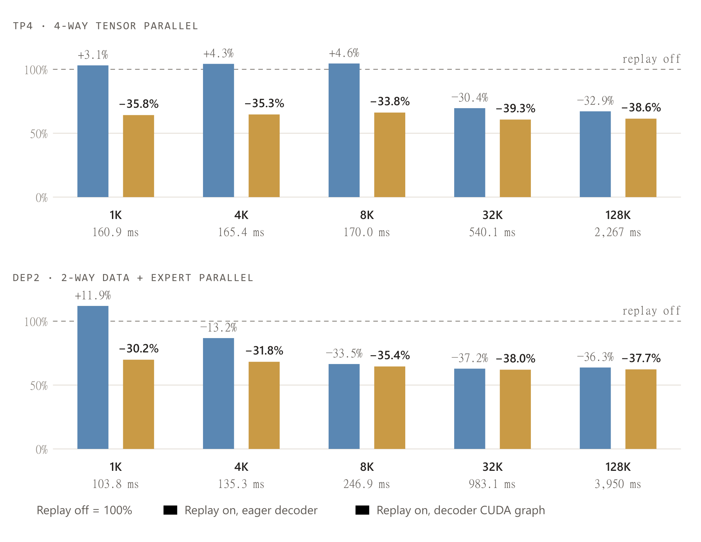
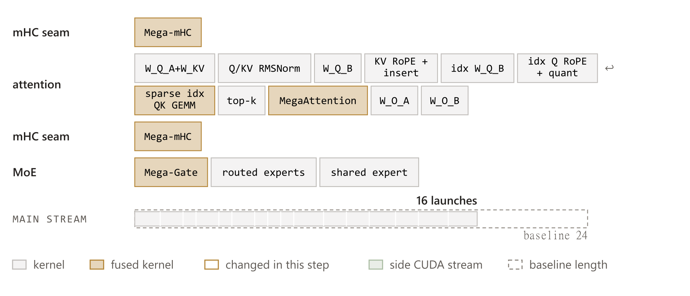
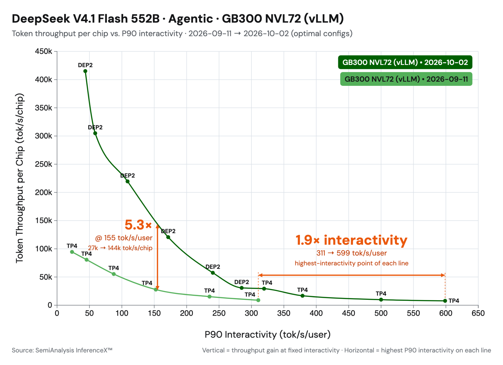
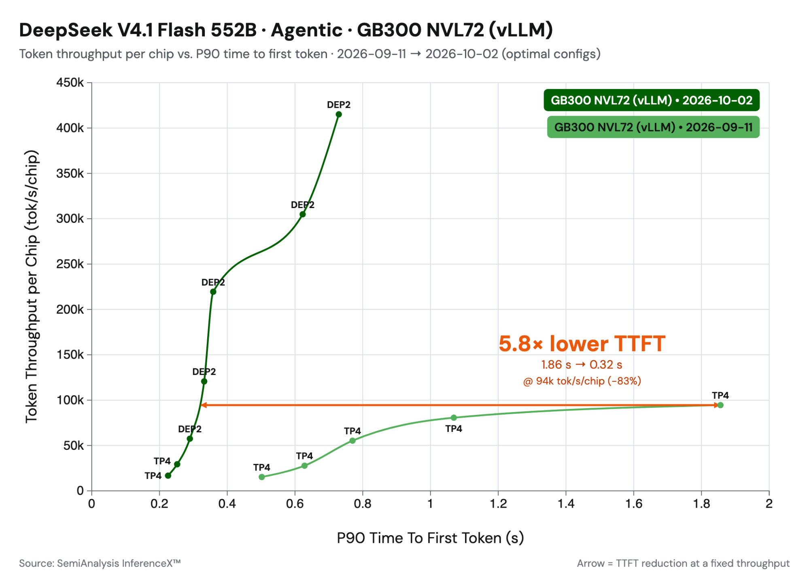

# vLLM × DeepSeek-V4.1-Flash 案例精读：长上下文 agentic serving 的显存账本

> 本文精读 vLLM 官方博客《DeepSeek-V4.1-Flash on vLLM: 5x Agentic Throughput Since Day 0》（2026-10-07，作者 Inferact 与 vLLM Team），并在原文之上补两件事：把散在模型层、系统层、算子层与实测里的机制与收益压成可对照的成本—收益表，逐条标出证据口径；补三处原文没有做的交叉验算（L × W = 5,120、19 / 40 = 47.5%、图4 十个格子逐格复算），并把原文正文与配图之间的一处口径不一致单独点出。

---

## 0. 一眼看懂

| 维度       | 结论                                                                                                                                                                                        |
| -------- | ----------------------------------------------------------------------------------------------------------------------------------------------------------------------------------------- |
| 这篇文章在做什么 | 给长上下文 agentic serving 的显存难题找一个不用缓存滑动窗口 KV 的解法：用有界重放重建 SWA KV、跳过解码器不需要的 19 层，再接入一批 DeepSeek 开源的融合与稀疏 kernel                                                                                |
| 测量的负载    | SemiAnalysis AgentX：多轮、长上下文、跨轮大量复用前缀的工具调用型智能体 serving                                                                                                                                     |
| 模型与硬件    | DeepSeek V4.1 Flash 552B；端到端跑在 GB300 NVL72 上，TTFT 微基准跑在 GB200 上                                                                                                                           |
| 比较对象与条件  | 基线是 2026-09-11 的 vLLM Day-0 实现，优化后是 2026-10-02 的结果，两端各取当日最优配置——它是三周内端到端能力的量级变化，不是单变量消融                                                                                                    |
| 最强的一组数字  | 固定 155 tok/s/user 的交互性约束下，每芯片吞吐 27k → 144k tok/s/chip，即 **5.3×**                                                                                                                          |
| 交互性      | 两条曲线各自最高交互性点对比 311 → 599 tok/s/user，即 **1.9×**                                                                                                                                            |
| TTFT     | 固定 94k tok/s/chip 时 1.86 s → 0.32 s，即 **5.8×（−83%）**                                                                                                                                      |
| 最值得带走的三条 | ① 近似算法必须配执行方式才能兑现——有界重放降了计算量，但短 prompt 上不用 CUDA graph 反而慢 12%；② 优化点普遍落在「让成本不随上下文增长」——重放窗口固定 128、跳过层固定 47.5%、稀疏打分固定 16K 候选；③ 端到端倍数里混着配置切换，1.86 s → 0.32 s 同时换了并行策略、attention 后端与 kernel 实现 |
| 最稀缺的部分   | 原文把五个被实验推翻的直觉写成了反例并给出机理（裁剪层 eager 执行反而更慢、MegaAttention 在低延迟下输给 FlashInfer、高吞吐不该上 TP），但正文与配图在 TTFT 降幅上留有一处未自洽（见第 9 节）                                                                      |

---

## 1. 背景：长上下文 agentic serving 的显存账本

### 1.1 负载画像

原文用的基准是 SemiAnalysis AgentX，一个面向工具调用型智能体的 serving 负载：多轮、长上下文、每轮之间大量复用前缀。这类负载的压力不在峰值算力，而在 KV cache 的驻留体积和多轮之间的缓存命中率。

| 维度     | 取值                                            |
| ------ | --------------------------------------------- |
| 场景     | 多轮长上下文 agent serving，前缀跨轮复用                   |
| 模型     | DeepSeek V4.1 Flash 552B                      |
| 激活参数   | prefill 每 token 8B，decode 每 token 16B         |
| 全局 KV  | 890 B/token（CSA2 压缩 + FP4 + 40 层共享）           |
| SWA KV | FP8 未压缩，每层保留最近 128 个位置                        |
| 层数与分工  | 共 40 层；layer 20 产出解码器用的全局 KV，layers 21–39 复用它 |
| 硬件     | GB300 NVL72                                   |

### 1.2 V4.1 自带的省显存设计

V4.1 的架构选择直接决定了后面的优化空间，有三件事值得单独记住：

1. **CED（因果编码器-解码器）结构**：prefill 每个 token 只激活 8B 参数，decode 激活 16B 参数。这既是省算力，也意味着 prefill 与 decode 的最优执行形状不同。
2. **全局 KV 被压到 890 B/token**：CSA2 压缩注意力、FP4 存储、以及层间共享三件事叠加的结果。40 层共享同一份全局 KV `latent`，是后面「TP 会复制 KV、所以改用 DP」这条结论的根源。
3. **滑动窗口 KV（SWA KV）保持未压缩的 FP8**：每层保留最近 128 个位置。它不参与压缩也不参与层间共享，因为它是「最近、精确」的那一份。

这三件事合起来把长上下文的显存账本压得很低，但也把两个新成本留给了推理框架。

### 1.3 省显存留下的两笔账

- **第一笔：prefix cache 存不下 SWA KV。** 前缀缓存要在每个可能的命中边界上都留下一份 SWA KV，原文给出的量级是「全局 KV 存储的 10 倍以上」。对一个本来就以显存效率为卖点的模型来说，这笔开销直接抵消了架构收益。
- **第二笔：prefill 白跑 19 层。** prefill 会在每个 prompt token 上跑 layers 21–39，但解码时只读它们最后 128 个位置的 SWA KV。也就是说，这 19 层在长 prompt 上的绝大部分计算是浪费的。

原文的优化就是围绕这两笔账展开，再加上一条并行的算子线。

## 2. 论证结构：模型—系统—算子三条线

图1 把原文的四段结构串成一条链：模型层给出的约束 → 系统层的有界重放 → 算子层的融合与稀疏 → 实测收益。后文第 3 节对应第二段，第 4 节对应第三段，第 5 节对应第四段。

需要单独指出的是，这三条线并不是可以互相替代的关系。系统层的收益（跳过 47.5% 的层）依赖模型层的结构事实（layer 20 是唯一的全局 KV 产出层）；算子层的融合收益依赖系统层先解决「裁剪后的层太多、太碎」这个问题，否则 fused kernel 也只是把零碎工作打包得更紧凑一点。

## 3. SWA bounded replay：用不精确换可缓存

### 3.1 精确重算的代价

最直接的做法是不缓存 SWA KV，每次需要时重算。问题在于精确重算很贵：某一层最后一个 128-token 窗口，注意力要回溯到下一层更早的位置，因此要重建它就得让下一层多算一个窗口；逐层展开，依赖关系是一个每层加宽一格窗口的阶梯。

原文给的量级是「重放约 L × W 个 token」。代入 V4.1-Flash 的 L = 40、W = 128，就是 40 × 128 = **5,120 个 token**，而且每一层都要走一遍。图2(a) 画的就是这个阶梯：层数越往下，要重算的窗口越多，最底层要重算 6 个窗口（示意为 6 层，实际 40 层）。

### 3.2 有界重放与编码器侧

DeepSeek 给出的办法是 **SWA bounded replay**：只重算最后 128 个 token，并把窗口在重放起点 s 处裁掉。结果不是逐位精确的，但重放量从 O(L × W) 降到 O(W)。图2(b) 是同一条阶梯在 s = H − 128 处被裁断之后的样子：只有最右列被重算，左边整片阶梯变成「跳过」，两张成本条分别标出 L × W = 5,120 与 W = 128。

vLLM 在两个地方用了它，对应第 1.3 节的两笔账。

**编码器侧**：vLLM 只缓存全局 KV，不缓存 SWA KV。前缀命中长度为 H 时，它重跑 `[H − 128, H)` 这段 token 来重建 SWA KV，窗口在 `s = H − 128` 处裁剪。

这里有一个容易被误读的地方：编码器侧省的是**显存**，不是时间。它用「每个命中多算一个窗口」换掉了「缓存 SWA KV」的存储，而原文明确写了「速度收益来自解码器侧」。把编码器侧当成性能优化会得出错误的收益预期。

按 L = 40、W = 128 计算，重放量从 5,120 降到 128，是 40 倍的降幅。这个 40 倍是本文按原文给出的 L 与 W 推算的，原文没有把它作为一个数字写出来。

### 3.3 解码器侧：跳过近一半的层

解码器侧的改法更直接。V4.1 的 CED 结构里，layer 20 计算解码器要用的全局 KV，layers 21–39 复用它。因此：

- layer 20 必须在每个 token 上都跑，否则拿不到全局 KV；
- layers 21–39 只在每个请求最后 128 个 token 上跑就够了，因为解码只读它们最后 128 个位置的 SWA KV。

于是长 prompt 上被跳过的层数是 19 / 40 = **47.5%**，接近一半。图3 是这一步的静态结果：最上面是 layers 0–19 的编码器段，layer 20 一行同时标出 SWA KV 与全局 KV，下面 layers 21–39 的前半段被「skipped」盖住，只剩最右一列（最后 128 个 token）仍然要算；右侧的两个括号标出 CUDA graph 的两段边界。

### 3.4 CUDA graph：让裁剪后的层真的变快

裁剪之后 layers 21–39 的 GPU 工作量太小，eager 执行会被 kernel launch 开销主导，GPU 大部分时间在空转。同时，裁剪后的输入形状与 layers 0–20 不同，两段无法捕获进同一张 CUDA graph。

vLLM 的 breakable PIECEWISE graph 本来就会在模型中间断开，这里正好成为一个天然切分点：layers 0–20 按完整 batch 捕获，layers 21–39 按裁剪后的 batch 单独捕获。这样裁剪过的 prefill 也能用上 CUDA graph，而且两段各自可以有自己的捕获尺寸，graph 覆盖率更高。

开关是 `--[no-]swa-bounded-replay`，在 DeepSeek-V4.1 上默认开启。

图4 是这一步的单请求 prefill TTFT 数据。柱高是相对「replay off」的百分比（越低越好），柱子下面给出绝对 TTFT；每一组从左到右分别是 replay off、replay on + eager decoder、replay on + decoder CUDA graph。

把图4 的绝对值整理出来：

| 配置   | prompt | replay off | on，eager decoder | on，decoder CUDA graph |
| ---- | ------ | ---------- | ---------------- | --------------------- |
| TP4  | 1K     | 160.9 ms   | 165.9 ms（+3.1%）  | 103.3 ms（−35.8%）      |
| TP4  | 4K     | 165.4 ms   | 172.5 ms（+4.3%）  | 107.0 ms（−35.3%）      |
| TP4  | 8K     | 170.0 ms   | 177.8 ms（+4.6%）  | 112.5 ms（−33.8%）      |
| TP4  | 32K    | 540.1 ms   | 376.0 ms（−30.4%） | 327.8 ms（−39.3%）      |
| TP4  | 128K   | 2,267 ms   | 1,522 ms（−32.9%） | 1,392 ms（−38.6%）      |
| DEP2 | 1K     | 103.8 ms   | 116.2 ms（+11.9%） | 72.5 ms（−30.2%）       |
| DEP2 | 4K     | 135.3 ms   | 117.4 ms（−13.2%） | 92.3 ms（−31.8%）       |
| DEP2 | 8K     | 246.9 ms   | 164.1 ms（−33.5%） | 159.4 ms（−35.4%）      |
| DEP2 | 32K    | 983.1 ms   | 617.8 ms（−37.2%） | 609.8 ms（−38.0%）      |
| DEP2 | 128K   | 3,950 ms   | 2,518 ms（−36.3%） | 2,460 ms（−37.7%）      |

口径是 NVIDIA GB200、3 次取中位数、prefix caching 关闭、单请求（见图4）。

### 3.5 精度代价与证据边界

有界重放不是逐位精确的：靠近 s 的被重放 token 本来会注意到 s 之前的位置，但那里没有窗口 KV，所以它的窗口被裁在 s 处。

原文给出两层证据：DeepSeek 报告质量损失可以忽略；vLLM 自己在 GSM8K 与 GPQA 上复核，没有观察到有意义的精度差异，差距在约 1.5 个标准误差以内。

这里的证据边界值得记下来：没有给出误差上界，没有 bit-exact 的对照实现，评测面只覆盖了两个数据集，且两个数据集对长上下文 agent 任务的代表性有限。「可以忽略」目前是一个经验判断，不是一条被界定的误差保证。对于把这条优化直接套到其他模型或任务上的读者，这是需要自己补测的部分。

## 4. 算子：把 DeepSeek 的开源 kernel 接进来

DeepSeek 随 V4.1-Flash 一起开源了新 kernel，分布在三个仓库里：DeepSelect（新的 top-k 库）、DeepGEMM（稀疏索引 kernel 与若干 GEMM 融合 kernel）、FlashMLA（NVFP4 KV 支持与融合注意力 kernel MegaAttention）。vLLM 把其中若干接入并继续融合，进度记录在 PR #57448。

图5 是接入加融合之后，DEP2 路径上**一次解码层**的主流程：一个方块代表一次 kernel launch，标为「fused kernel」的是被融合出来的 kernel，标为「changed in this step」的是这一步改动的部分；底部的条尺给出本步的 launch 数与融合前的基线。图5 对应的是 DEP2 分组走完融合后的终点态：**16 次 launch，基线是 24 次**。

下面按原文的三类收益整理。

### 4.1 融合：把多次 launch 与往返读写压成一次

- **MegaAttention（#56935）**：把 query RoPE、稀疏注意力、输出端反 RoPE、FP8 量化全部做进一次 launch，直接写进输出投影要读的 buffer。它同时读取新的 NVFP4 压缩 KV 格式，比原来的 FP8 KV cache 小 45%；靠消除中间操作的 HBM 写回，kernel 效率提升 1.45 倍。
- **Mega-mHC（#56962）**：把 mHC 链上的 post、delayed-pre 与 RMSNorm 融合成一个 kernel，替换掉原来的 TileLang 融合路径。在 NVIDIA GB200 上比 TileLang 版本快 1.14–1.51 倍。
- **Mega-Gate（#56266）**：把 MoE router 的 gate GEMM、专家打分、bias 与 top-k 选择融合进一个 kernel。融合前这是一次 GEMM 加一次独立的 top-k kernel，多一次 launch、多一次打分的显存往返。中等 batch 下提速 1.18–1.31 倍。
- **低延迟融合 WO-A（#58634）**：针对 Blackwell 上的小 batch 解码，把反 RoPE、FP8 量化、WO-A batch GEMM 与 MXFP8 重量化融合成一个 CuTe-DSL kernel，把 WO-B 之前的链条从三个 kernel 减到一个。关键是把中间激活留在片上，并让数据搬运与计算流水起来。这条路径最高提速约 2.1 倍，低并发下 inter-token latency 最多降 6–7%。

### 4.2 稀疏与压缩：让成本不随上下文增长

- **稀疏 MQA logits（#56254）**：V4.1 后续的 indexer 层从固定的 16K 个候选位置里选 top-k。此前的实现会为整条上下文打分，再把非候选块 mask 掉；DeepGEMM 的稀疏 kernel 只给候选打分，成本因此不再随上下文增长。单层在 NVIDIA GB300 上：8K token 时快 1.2 倍，512K 时快 14–23 倍。4× GB300 上端到端解码提升 3–6%；prefill 在 512K 时快 1.43 倍，1M 时快 2 倍。
- **NVFP4 压缩 KV**：接在 MegaAttention 里，比 FP8 KV cache 小 45%，直接换来每张卡能承载更高的并发。

### 4.3 重叠与访存：把等待搬到别的地方

- **mHC 多流重叠（#57603）**：V4.1 里 mHC 系数错开了一个子层，下一个 seam 的系数 GEMM 只读已经存在的残差流，因此既不需要等 attention，也不需要等 FFN 的输出。vLLM 在小 batch 下把下一个 mHC 块的系数计算放到旁路 CUDA stream 上，与 attention 和 FFN 并行执行，把原本在延迟关键路径上的工作藏起来。TP4 低延迟场景下延迟约降 4%。
- **Engram**：V4.1 的 Engram 层按哈希后的 token n-gram 从两张大的 FP8 表里查行，每步只读几行，因此瓶颈是表的位置与查表延迟而不是计算。vLLM 做了几件事：异步预取放在 CPU 上、与解码计算重叠（#56512）；Engram head 用统一的 TP/DP 切分，同一 DP 副本共享主机侧表，避免冗余拷贝、查表路径上不引入 DP 通信（#57651）；用透明大页（THP）降低缺页开销，prefill 的查表 kernel 最高快 10 倍（#56926），并补了巨页不足时的处理（#59327）。

## 5. 实测结果

### 5.1 实验口径

| 项目    | 取值                                                    |
| ----- | ----------------------------------------------------- |
| 基准    | SemiAnalysis AgentX（工具调用型 agent serving）              |
| 模型    | DeepSeek V4.1 Flash 552B                              |
| 端到端硬件 | GB300 NVL72；kernel 数字部分来自 GB200 / GB300 单卡与 4 卡       |
| 对比    | 2026-09-11（Day-0）→ 2026-10-02（优化后），各点取最优配置            |
| 低延迟配置 | TP4 + FlashInfer attention                            |
| 高吞吐配置 | DEP2（2-way data + expert parallel，DP attention 且专家分卡） |
| 指标    | 每芯片 token 吞吐（tok/s/chip）、P90 交互性（tok/s/user）、P90 TTFT |

有一处口径需要读者自己留意：图4 的微基准跑在 GB200 上，而图6、图7 的端到端跑在 GB300 NVL72 上。跨图比较加速比时不能直接乘。

### 5.2 吞吐与交互性

图6 是同一份 AgentX 基准上 Day-0 与优化后两条曲线的对比。两条读数：

- 固定 155 tok/s/user 的交互性约束下，每芯片吞吐从 27k 提升到 144k tok/s/chip，即 **5.3×**；
- 两条曲线各自最高交互性点的对比是 311 → 599 tok/s/user，即 **1.9×** 的交互性提升。

两个配置的选择本身有信息量：

- **低延迟用 TP4**，因为小 batch 解码基本是显存带宽受限，把权重切到四张卡上是合适的。值得注意的是，他们试过在这个场景用 MegaAttention，但收益远小于高吞吐场景，最后 FlashInfer 反而更快。
- **高吞吐切到 DEP2**。原因是 V4.1 在所有 head 之间共享同一份 KV `latent`：TP 会在每张卡上复制 KV cache，而 DP 只让每张卡存自己服务的那部分请求的 KV。会话亲和性保证前缀缓存在多轮之间仍然有局部性；MegaAttention 的 NVFP4 再把每请求的 KV 占用压掉近一半，直接换成每卡更高的并发。

另外原文提到，整个基准过程中 V4.1 都没有用到 KV cache offloading，他们预期要到并发更高、并且做了 P/D 分离之后 offloading 才会开始有用。这部分没有数据。

### 5.3 TTFT

图7 是优化后的 TTFT–吞吐权衡。原文正文的说法是：在约 100K 吞吐附近，TTFT 下降近 70%，来自三件事叠加——有界重放让模型上半部分只处理最后 128 个 token、CUDA graph 让裁剪后的重放不再受 CPU launch 拖累、kernel 改进加快模型计算。

图7 自己的标注给出的是另一组数：固定 94k tok/s/chip 时，TTFT 从 1.86 s 降到 0.32 s，即 **5.8×，−83%**。这两处不一致，见第 9 节。

### 5.4 交叉验算

原文的多个表与图之间可以互相印证，这里做三处。

**（1）「30–40%」是相对 replay off，不是 CUDA graph 的增量。** 把图4 的十个格子逐格算 replay off 到 CUDA graph 的降幅：TP4 为 −35.8% / −35.3% / −33.8% / −39.3% / −38.6%，DEP2 为 −30.2% / −31.8% / −35.4% / −38.0% / −37.7%。十格全部落在 30.2%–39.3% 之间，与原文的「30–40%」严格吻合。如果误读成「CUDA graph 相对 eager 的增量」，同一批数据给出的只是 −38.0% 到 −1.3% 这样一个几乎跨越全部量级的区间，显然不成立。

**（2）裁剪层的执行方式决定了收益能否兑现。** 对比 eager 列与 off 列：短 prompt 上 eager 重放是**变慢**的（TP4 1K +3.1%、DEP2 1K +11.9%，原文正文写「up to +12% at 1K on DEP2」，与 11.9% 一致）；长 prompt 上 eager 已经拿到大部分收益（TP4 32K −30.4%、128K −32.9%）。再补上 CUDA graph 之后，短 prompt 才从「倒退」翻成 −30% 量级。这条链说明「跳过 47.5% 的层」这个结构简化本身不产生收益，收益来自结构简化加上匹配的执行方式。

**（3）47.5% 是理论天花板，实测 30–40% 是落地值。** 被跳过的 layers 21–39 是 19 层，19 / 40 = 47.5%，这是「假设每层代价相同」下 prefill 计算量的上限降幅。实测的 replay off → CUDA graph 降幅是 30–40%。差额来自两处：所有层仍然要重算最后 128 个 token，以及短 prompt 上 attention 的二次项占比更高、被跳过的层在总计算量里的份额本来就低于 47.5%。原文没有做这个对比，本文把它列出来是为了让「接近砍半」这个说法有一个可核对的上界。

## 6. 横向对比：各项优化的成本、收益与证据强度

| 优化                       | 针对的成本                         | 量化收益                           | 证据口径                    | 开关 / PR                           |
| ------------------------ | ----------------------------- | ------------------------------ | ----------------------- | --------------------------------- |
| 有界重放（编码器侧）               | prefix cache 存 SWA KV 的显存     | 不再缓存 SWA KV                    | 机制描述，无独立测量              | 默认开启 `--[no-]swa-bounded-replay`  |
| 有界重放（解码器侧）               | prefill 白跑 layers 21–39       | 跳过 19/40 ≈ 47.5% 的层            | 机制描述，实测见下一行             | #58132                            |
| 解码器侧 CUDA graph          | 裁剪层的 kernel launch 开销         | prefill 计算 −30–40%（相对 off）     | GB200 单请求，3 次中位数，前缀缓存关闭 | #59532                            |
| Mega-mHC                 | mHC 链上的多次 launch              | 1.14–1.51×                     | GB200 单 kernel          | #56962                            |
| Mega-Gate                | router GEMM 与 top-k 两次 launch | 1.18–1.31×（中等 batch）           | GB200 单 kernel          | #56266                            |
| mHC 多流重叠                 | 解码关键路径上的系数 GEMM               | TP4 低延迟延迟约 −4%                 | 未给测量细节                  | #57603                            |
| 稀疏 MQA logits            | 打分成本随上下文线性增长                  | 单层 512K 下 14–23×；e2e 解码 +3–6%  | GB300 / 4× GB300        | #56254                            |
| MegaAttention + NVFP4 KV | attention 前后多次 launch、KV 体积   | kernel 效率 1.45×；KV 比 FP8 小 45% | 未给端到端数字                 | #56935                            |
| 融合 WO-A（CuTe-DSL）        | 小 batch 下三次 launch            | 该路径最高约 2.1×；ITL −6–7%          | Blackwell 低并发           | #58634                            |
| Engram 预取与访存             | 主机侧大表查表延迟                     | prefill 查表 kernel 最高 10×       | 未给端到端数字                 | #56512 / #57651 / #56926 / #59327 |

这张表里最需要区分的是证据强度：右列有明确硬件与口径的（CUDA graph、Mega-mHC、Mega-Gate、稀疏 logits、WO-A）可以直接引用；只给了单 kernel 数字没有端到端的（MegaAttention、Engram）以及只给了机制说明的（编码器侧重放）在使用时应当保留余量。

## 7. 反例：五个被实验推翻的直觉

| 直觉                         | 实测结果                           | 机理                                          | 教训                                      |
| -------------------------- | ------------------------------ | ------------------------------------------- | --------------------------------------- |
| SWA KV 不必缓存，每次精确重算就好       | 精确重算要重放约 L × W = 5,120 个 token | 每层 128 窗口依赖下面一层更宽的窗口，逐层展开成阶梯                | 想用近似换效率，先把「精确」的代价算清楚                    |
| 把裁剪后的层照常 eager 跑就能拿到收益     | 短 prompt 反而更慢，DEP2 1K 上 +11.9% | 裁剪后 GPU 工作太少，launch 开销盖过节省                  | 结构优化必须配套执行方式才成立                         |
| 融合越激进越好，MegaAttention 应该通吃 | TP4 低延迟下 FlashInfer 更快         | 小 batch 下融合腾挪空间小，收益抵不过实现开销                  | kernel 取舍随 batch 与并行度变化，不能只看单 kernel 数字 |
| 高吞吐就该上 TP                  | 改用 DEP2（DP attention + 专家分卡）   | V4.1 所有 head 共享一份 KV `latent`，TP 会在每张卡复制 KV | 显存效率高的模型会改写并行策略的最优解                     |
| 稀疏注意力的关键是选出正确的 top-k       | 关键在打分阶段不能全量打                   | 只对固定 16K 候选打分，成本才不随上下文增长                    | 优化点常落在 top-k 之前而不是之后                    |

## 8. 洞察

**1. 这份工作的核心不是「把算子写快」，而是给一个近似算法配上能兑现它的执行方式。** 有界重放本身是模型侧给出的近似——放弃逐位精确、把窗口裁在 s 处，换来的是结构上的简化。但结构简化不等于时间收益：短 prompt 上 eager 执行甚至比不优化更慢（DEP2 1K +11.9%）。真正让它变成 −30% 至 −40% 的是 CUDA graph 分段捕获。近似与执行方式缺一不可，这也是原文标题里「Since Day 0」的含义——模型侧的近似从第一天就存在，缺的是框架侧的兑现手段。

**2. 真正可复用的模式是「把成本从随上下文增长搬到常数」。** 有界重放把重放量从 O(L × W) 搬到 O(W) = 128 个 token；解码器侧把参与 prefill 的层数从 40 层搬到 21 层；稀疏索引 kernel 把打分成本从 O(context) 搬到 O(16K 候选集)，于是在 512K 上下文上出现 14–23 倍的量级差。三件事的形式不同，但都是同一种搬法。评估一个新模型或新算子时，先问「哪一项成本乘了序列长度」，往往比先问「哪个 kernel 慢」更有产出。

**3. 端到端倍数里混着配置切换，引用时要拆开说明。** 图7 的 1.86 s → 0.32 s 同时换了并行策略（TP4 → DEP2）、attention 后端与 kernel 实现，它不是一次单变量消融；图6 的 5.3× 也是「2026-09-11 的最优配置」对「2026-10-02 的最优配置」，而不是同一套配置下代码变快 5.3 倍。把这些数字当作「同一模型在三周内端到端能力的量级变化」是合理的，当作逐项收益的加总则会高估每一项。原文自己给出的逐项数字（第 6 节表格）才是可以做归因的部分，而且其中一半只有单 kernel 口径。

## 9. 局限与读图注意

- **图2、图3、图4、图5 是原文可交互页面的静态等价物。** 交互才揭示的中间态（依赖锥的逐层展开、融合的逐步推进、柱状图的悬浮明细与数据表）在静态图里只能给出一帧；图2 用 (a)(b) 两帧分别呈现「精确重建」与「有界重放」的终点态。图5 取的是 DEP2 分组走完融合后的终点态，不是 TP4 分组。
- **原文正文与配图在 TTFT 降幅上不一致。** 正文写「约 100K 吞吐附近 TTFT 下降近 70%」；图7 的标注是「5.8× lower TTFT，1.86 s → 0.32 s @ 94k tok/s/chip（−83%）」。图7 的标注内部自洽（1.86 / 0.32 = 5.81）。两者相差较大，且吞吐点不同（100K 与 94K），最可能是两处分别测量的结果。引用时应以图7 的端点数字为准，或直接引用原始基准。
- **TL;DR 的「约 30%」与正文的「30–40%」。** 原文摘要写的是一个约数，正文与图4 对应的是 30–40%，两者不冲突但精度不同。
- **150 TPS 与 155 tok/s/user 是同一个约束的两种写法**，前者在摘要里，后者在图6 的标注上。
- **硬件口径跨图不统一。** 图4 的微基准在 GB200 上，kernel 数字来自 GB200 / GB300 单卡或 4 卡，端到端在图6、图7 的 GB300 NVL72 上。把图4 的百分比与图6 的倍数直接相乘是不成立的。
- **精度证据偏薄。** 只有 GSM8K 与 GPQA 两个数据集，「差距在约 1.5 个标准误差以内」，没有误差上界，也没有 bit-exact 对照。对有严格数值要求的场景，这部分需要自行复测。
- **本文能验算的只有三项**：L × W = 5,120、19 / 40 = 47.5%、以及图4 与图6、图7 中的端点比值。其余数字（890 B/token、SWA KV 缓存超过全局 KV 的 10 倍、NVFP4 比 FP8 小 45%、THP 带来 10× 查表提速）均直接引用原文，其中部分转引自 V4.1 模型报告，没有独立验算条件。
- **KV offloading 全程未启用**，原文只给出预期（更高并发 + P/D 分离时会有用），没有数据。

---

## 10. 原文资源

- 原文：vLLM 官方博客《DeepSeek-V4.1-Flash on vLLM: 5x Agentic Throughput Since Day 0》，2026-10-07，作者 Inferact 与 vLLM Team。https://vllm.ai/blog/2026-10-07-deepseek-v41-flash
- 基准：SemiAnalysis AgentX / InferenceX 智能体 serving 基准，图6 与图7 的吞吐—交互性曲线的数据来源，图中标注为 Source: SemiAnalysis InferenceX™
- 模型报告：DeepSeek-V4.1 模型报告（原文中 890 B/token、40 层共享 KV `latent` 等模型侧数字的转引出处，原文写作「V4.1 report」，未给出直接链接）
- 主要 PR：kernel 接入跟踪 #57448；解码器侧重放 #58132；裁剪层 CUDA graph #59532；Mega-mHC #56962；Mega-Gate #56266；mHC 多流重叠 #57603；稀疏 MQA logits #56254；MegaAttention + NVFP4 KV #56935；融合 WO-A #58634；Engram #56512 / #57651 / #56926 / #59327
- 关键配置项：`--[no-]swa-bounded-replay`（DeepSeek-V4.1 上默认开启）；低延迟路径 TP4 + FlashInfer attention；高吞吐路径 DEP2（DP attention + 专家分卡）
- 微基准口径：图4 为 NVIDIA GB200、3 次取中位数、prefix caching 关闭、单请求
