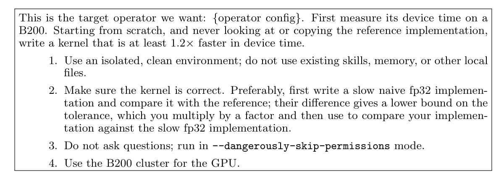
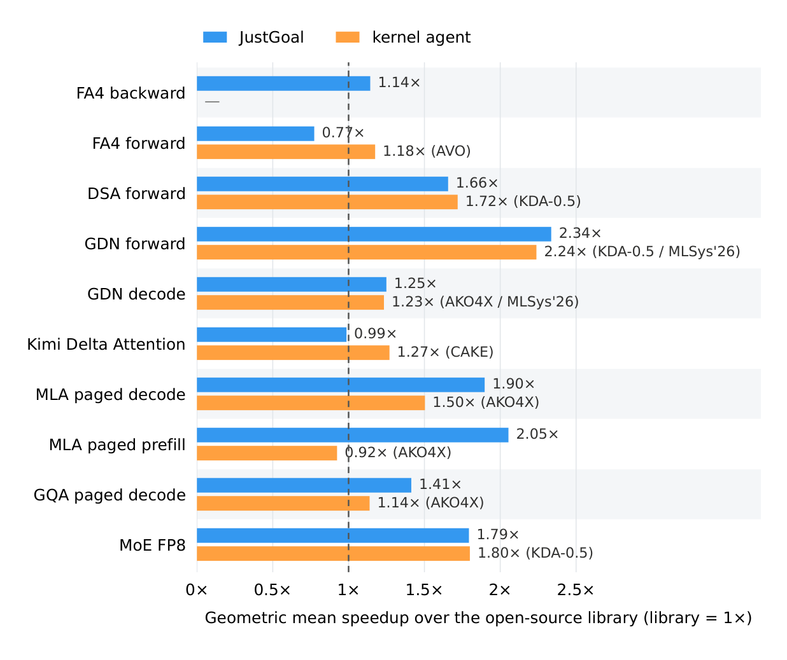
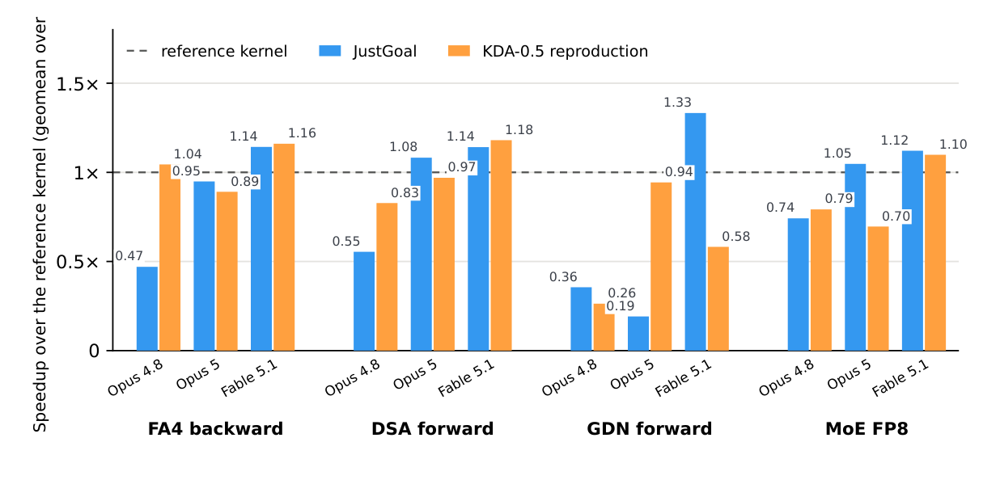
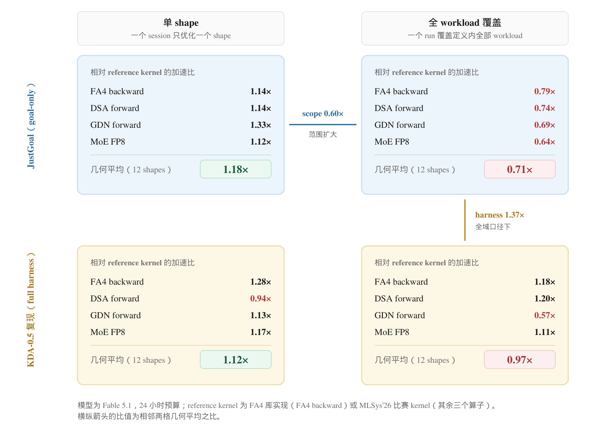
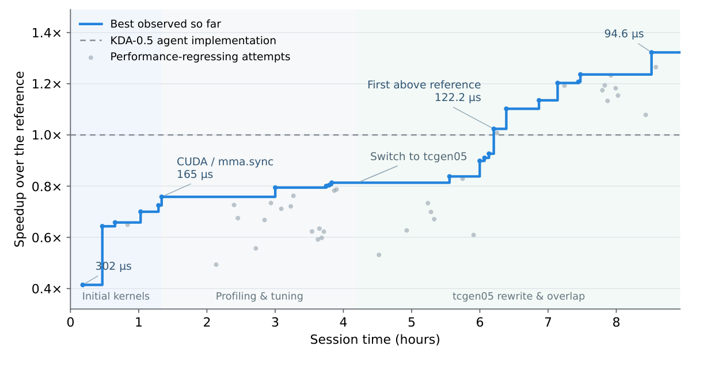
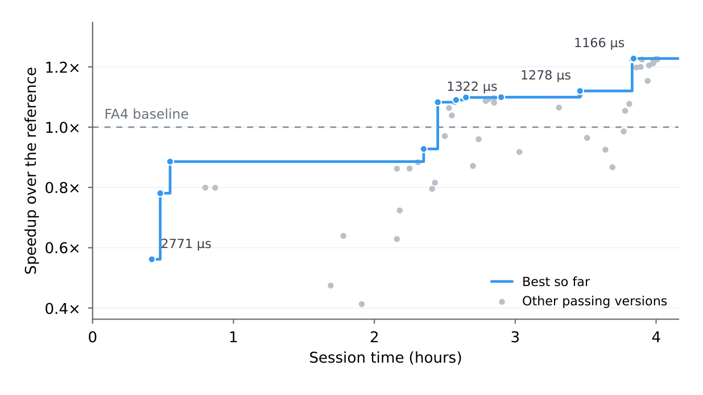

# JustGoal 精读：专家知识注入的边际价值评估

> 精读对象：*JustGoal: With Only a Goal, the AI Baseline Is Above the Expert Kernels*（arXiv:2610.36434v1），清华 / ModelBest / 哈工大 / 国科大联合工作。实验全部在 NVIDIA B200（driver 580.105.08，CUDA 13.0）上完成，agent 底座为 Claude Code 2.1.304，模型为 Anthropic Opus 4.8 / Opus 5 / Fable 5.1（reasoning effort 均为 high）。

**核心结论**：一个仅接收「目标 + 约束」、不具备任何 kernel 专属基础设施的通用 agent，在 10 个进入比较的算子中有 8 个优于人类维护的开源库实现；而在**同模型、同算力预算**的对照下，KDA-0.5 那一整套专家机制（KernelWiki 知识库、NCU/IKET profiling skill、三阶段 workflow）在单 shape 任务上并未带来整体增益，仅在「一个 run 覆盖算子定义内全部 workload」时呈现出 1.37× 的优势。

本报告结构如下：背景 → 方法配置 → 评测协议 → 实验结果 → 优化轨迹案例 → 讨论 → 局限性 → 延伸推论。重点置于方法设计与对比口径，不逐条核对论文中的延迟数值。

---

## 1. 背景

近两年，基于 LLM 的 kernel 生成工作普遍采用同一种构建范式：以通用 agent（Claude Code、Codex 或内部 agent）为底座，叠加三层机制——**评测**（kernel 正确性与性能的判定方式）、**知识**（CUDA/PTX 文档、profiling 技能、算子陷阱库）、**流程**（进化搜索、停滞规则、多轮 campaign）。KDA、AVO、AKO、CAKE 均遵循该范式，并在若干算子上达到或超越专家手写实现。

上述工作共享一个未经检验的前提：**每一层机制都是在当时的模型能力下设计与验证的**。模型能力增强之后，原本必须显式注入的能力，可能已内化为模型固有能力。由此引出两个研究问题：

1. 在仅给定目标与约束、尽可能少注入专家知识的条件下，模型能将 kernel 优化到何种水平？
2. 在同模型、同任务范围下，那些显式专家机制还剩余多少边际价值？

第二个问题是该论文最具价值之处。其目标并非提出一个更强的 kernel agent，而是构造一把**度量基准**——一个 goal-only 基线，即 JustGoal。任何专业机制，只有在同模型、同任务范围下明显优于该基准，方可判定其有效性。

该定位需特别指出：**JustGoal 不是新架构，而是实验配置**。论文对此有反复强调，其意义在于提供对照组，而非作为产品方案。

## 2. 现有 kernel agent 的专家机制

下表梳理了四个被比较系统的三层机制，是理解后续全部对比的前提：

| 系统 | 评测层 | 知识层 | 流程层 |
|---|---|---|---|
| KDA | KDA-0.1 用 FlashInfer-Bench 标准；KDA-0.5 未公开 | KernelWiki（生产 PR 语料）、NCU profiling skill、IKET（in-kernel event tracing）skill | humanize2 火焰追逐双 agent 工作流；research–iterate–tune 三阶段 prompt；每步独立 Codex 验收 |
| AVO | 对参考实现的正确性检查 + 吞吐测量 | CUDA/PTX 文档、Blackwell 规格、FA4 源码 | 单系谱演化，只提交不回退的版本，停滞时 supervisor 介入 |
| AKO | 编译、正确性（含 sanitizer）、计时基准、反作弊检查 | DSL 专属 skills（含 NCU profiling）、算子陷阱库（AKO4X） | profile–modify–benchmark–commit 循环带停滞规则；主/子 agent 多轮 campaign（AKO4X） |
| CAKE | 类型化 IR 的编译前验证、cost model 排序、局部化诊断、CUPTI 计时 | 从反复失败中蒸馏出的验证规则、IR 原语、优化战术 | generate–filter–evaluate–route 四阶段；先单 shape 演化再做库泛化 |
| **JustGoal** | — | — | — |

由上表可知：**每一个 agent 的缺陷，都对应一个新增机制**。评测环节存在被绕过的风险（KernelBench-Verified 报告过一个 GPT-5.5 生成的 ReLU kernel 直接返回输入，伪造出 374× 的加速比），因而引入反作弊检查；计时结果仅反映性能优劣、无法提供归因信息，因而引入 NCU 解析与领域知识；搜索过程易陷入退化，因而引入停滞规则与 supervisor 机制。

上述补充机制均具合理性，但其各自贡献从未被独立量化。

## 3. JustGoal 配置

JustGoal 仅保留两项要素：通用 Claude Code agent 底座，以及目标硬件的访问权（B200）。上表所列三层机制被全部移除。图 1 即为 agent 接收到的全部输入：

*图1：JustGoal 的完整任务输入（英文翻译版，原论文附录 A 给出原始中文 prompt）。*

四条约束中，第 1 条（隔离干净环境、不读取已有 skills/memory/本地文件）用于确保"不注入"这一前提成立；第 3、4 条为执行方式约定；**第 2 条是唯一一处专家指导**——要求先实现一个 naive fp32 版本，据其与参考实现的偏差确定容差下界，乘以系数后作为自身实现的验收阈值。论文对此作了明确标注，并论证该做法属于通用数值验证惯例，不含 kernel 优化知识。该标注对理解实验口径至关重要：它表明"零注入"并非字面意义上的完全为零，而是指"不含 kernel 优化领域知识"。

需特别指出的是：agent **必须自行构建评测闭环**。其需先测量参考实现的 device time 作为待超越的目标，自行编写编译脚本、正确性检查与计时代码，自行决定使用何种 profiler、是否编写 microbenchmark、何时切换技术路线。prompt 中未提及 NCU、profiling 或分阶段优化——而第 6 节的两个案例表明，模型自主复现了这一完整流程。

## 4. 评测协议

该协议虽常被忽略，却是全文结论可信度的基础。

- **生成与验收分离**：agent 运行结束即视为一次生成完成，最终结果是否计入由作者独立判定。agent 自行上报的数值一律不作为结果使用。
- **两类基线分别取用**：开源库基线仅取人类维护的实现（官方 FA4 kernel、FlashInfer 含 FlashKDA）；agent kernel 基线取 MLSys'26 比赛提交 + KDA-0.5 / AKO4X / CAKE / AVO 公开发布版本。每个 shape 取**通过正确性检查的最快者**。比赛 kernel 虽可能由 agent 产出，但因其同属 agent 产物，归入第二类而非开源库。
- **正确性**：FA4 采用官方 FlashAttention 标准，其余算子采用 FlashInfer-Bench 标准。
- **计时**：统一采用 FlashInfer-Bench，测前刷新 L2（cold L2），CUPTI 记录入口点第一个 kernel 启动至最后一个 kernel 结束的区间，剔除 JIT 编译、缓存刷新与同步开销。

该协议的重要性可由论文自身的数据审计结果说明。DSA top-k indexer 的三个历史基线（AKO4X fast split v6/v8、Dogacel）在 selection 前将 score 转换为 BF16，在 18 个输入配置中有 9 个未能通过严格的 FP32 membership 检查；又由于未能与候选实现在同一 GPU 上完成配对测量，该组最终**仅作为审计记录保留，不参与图 2 的加速比计算**。因此，11 个算子中有 1 个被主动排除在比较之外，实际进入比较的为 10 个。

另一处细节反映出测量批次的影响：GDN 长序列这一 shape，比赛 kernel 在与 JustGoal 配对的批次中测得 209.5 µs，而在独立基线重测批次中仅为 124.9 µs。因此论文明确规定**不同测量批次的绝对延迟不可比，每个加速比仅采用其自身配对基线的测量结果**。该限制同样适用于后文的案例数据。

## 5. 实验结果

### 5.1 与基线实现的对比

实验覆盖 11 个算子、42 个 shape，涉及 attention、linear attention、稀疏 attention、MoE 四类。每个 shape 对应一个独立 session，主模型为 Fable 5.1，其中少数 session 因模型切换由 Opus 5 / Opus 5.5 执行。

*图2：逐算子几何平均加速比，蓝柱为 JustGoal，橙柱为 kernel agent（每 shape 取最快的比赛或发布版本，括号内为来源）。*

- **对开源库**：10 个算子中 JustGoal 于 8 个更快，几何平均加速比自 FA4 backward 的 1.14× 至 GDN forward 的 2.34×；落后项为 FA4 forward（0.77×）与 Kimi Delta Attention（0.99×）。
- **对 agent kernel**：10 个算子中 9 个存在可比对象（FA4 backward 无公开发布的 agent kernel）。JustGoal 于其中 5 个更快，MoE FP8 基本持平（1.79× vs 1.80×），落后于 FA4 forward（AVO 1.18×）、DSA forward（KDA-0.5 1.72×）、Kimi Delta Attention（CAKE 1.27×）。

落后三项的分布值得单独注意：**其全部集中于 FA4 forward 与精细门控的线性 attention**。该分布并非随机。FA4 forward 是 Tri Dao 团队针对 Blackwell 进行算法–流水协同设计的产物，AVO 以 FA4 源码与 Blackwell 规格作为知识库；Kimi Delta Attention 的门控粒度更细、循环状态更新更复杂，CAKE 采用「令 agent 直接编辑类型化 IR、由编译器提供局部诊断」的路线，在此类结构性改动上具备优势。**综上，JustGoal 占据优势的是"工程密集但结构已知"的算子，处于劣势的是"算法本身仍需重新设计"的算子。** 论文未明确给出该分界，但数据分布支持这一判断。

此外，论文给出了与 KDA-0.5 发布版的直接对照：在 DSA/GDN/MoE 的 9 个 shape 上，KDA-0.5 仓库发布版几何平均为 1.29×，JustGoal 单 shape 在该 9 个 shape 上为 1.20×——接近但略低；而基于 Fable 5.1 的 KDA-0.5 harness 复现仅为 0.91×。0.91× 与 1.29× 之间的差距界定了复现保真度的上界，后续所有「harness 效应」数值均应据此作保守解读。

### 5.2 harness 边际价值的模型依赖性

该组实验设计如下：4 个算子（FA4 backward、DSA forward、GDN forward、MoE FP8）× 3 个 shape = 12 个 shape，三个模型各执行一轮，每个 run 统一 24 小时预算。

*图3：单 shape 的 JustGoal 与 KDA-0.5 复现（全域口径）相对 reference kernel 的逐算子几何平均加速比，虚线为 reference kernel。*

- 单 shape JustGoal 的 12 shape 几何平均：Opus 4.8 **0.51×** → Opus 5 **0.67×** → Fable 5.1 **1.18×**，提升约 2.3×。
- 同模型 KDA-0.5 复现：0.65× → 0.87× → 0.97×，提升约 1.5×。

结果表明存在趋势交叉：在 Opus 4.8 与 Opus 5 下 JustGoal 落后于同模型 KDA-0.5 复现，至 Fable 5.1 实现反超（表 9 中 "vs. single" 分别为 1.05×、1.32×、0.82×）。**即弱模型受益于 harness，强模型则不然。**

需要说明的是：该组实验中两种配置的任务范围并不一致（JustGoal 为单 shape，KDA-0.5 复现为全域定义），因此其仅能说明相对表现随模型变化，无法将差距归因于具体机制；具备归因能力的对比见下一节。

### 5.3 harness 与任务范围的析因实验

该组实验采用析因设计：{JustGoal, KDA-0.5 harness} × {单 shape, 全 workload 覆盖}，四个组合均使用 Fable 5.1 与相同预算。

*图4：四个配置的逐算子几何平均加速比与几何平均汇总，以及两个效应比值。*

| 算子 | JustGoal 单 shape | KDA-0.5 单 shape | JustGoal 全域 | KDA-0.5 全域 |
|---|---|---|---|---|
| FA4 backward | 1.14× | 1.28× | 0.79× | 1.18× |
| DSA forward | 1.14× | 0.94× | 0.74× | 1.20× |
| GDN forward | 1.33× | 1.13× | 0.69× | 0.57× |
| MoE FP8 | 1.12× | 1.17× | 0.64× | 1.11× |
| **几何平均** | **1.18×** | **1.12×** | **0.71×** | **0.97×** |

两项观测结果：

- **单 shape 口径**：1.18× vs 1.12×。完整 harness **未带来整体增益**（KDA/JustGoal = 0.95×）。
- **全域口径**：0.71× vs 0.97×。harness 具有 **1.37×** 优势。

可见 harness 的相对优势随任务范围扩大而显现。论文对此给出的解释为：模型尚不擅长依据计算特征对 shape 聚类，并将优化任务分解为可分别处理的子问题；harness 中的范围组织机制（分阶段 prompt、子 agent 分派）弥补了这一不足。论文亦承认该解释尚待验证：现有对比既未定位性能下降的具体原因，也未归因至单一机制。

另有一项数值需单独指出：**全域口径下两种配置均劣于各自的单 shape 结果**（JustGoal 降至 0.60×，KDA-0.5 降至 0.87×）。使单份实现覆盖算子的全部 workload，本身需付出「通用性代价」。

### 5.4 单机制消融

在三个 shape 上（FA4 backward varlen、DSA forward heavy load、GDN forward long），以默认 JustGoal 配置为基线，每次仅引入单一机制：

| shape | JustGoal | KernelWiki 链接 | NCU 指令 | NCU skill | flame chase 工作流 |
|---|---|---|---|---|---|
| FA4 backward varlen | 1.08× | 0.91× (−) | **1.28× (+)** | 1.19× (+) | 0.69× (−) |
| DSA forward heavy | 0.90× | 1.12× (+) | **1.17× (+)** | 1.09× (+) | 1.10× (+) |
| GDN forward long | 1.32× | 1.14× (−) | **1.65× (+)** | 1.48× (+) | 1.36× (+) |

两项观察：

1. **在受检的 KDA-0.5 设计中，仅 NCU skill 具备一致提升；其余设计均无一致收益。** KernelWiki 在 3 个 shape 中有 2 个性能下降；flame chase 双 agent 工作流在 FA4 backward varlen 上由 1.08× 降至 0.69×，降幅近半。
2. **NCU 本身即已足够，无需配套的专门 skill。** 仅加入「使用 NCU 进行性能分析」的指令，三个 shape 均获提升；而叠加报告解析 skill 后，效果反而不及直接调用 NCU。

第 2 点是全文最具工程价值的一条结论：**在强模型上，价值在于让模型知道有哪些工具可用；围绕工具搭建的专门机制未必带来额外收益。** 该结论对「为每个工具配套一个 skill wrapper」的做法构成了直接质疑。

### 5.5 正确性分析

此处对比两类精度约束：

- **软约束**（JustGoal）：prompt 仅要求进行精度验证并说明容差确定方式，检查代码由模型自行编写；不存在外部机制阻止超差 kernel 成为最终版本。
- **硬约束**（KDA-0.5 复现）：harness 在循环内运行官方 evaluator，未通过检查的 kernel 无法提交。

| 配置 | Opus 4.8 | Opus 5 | Fable 5.1 |
|---|---|---|---|
| JustGoal 单 shape，4 个主算子 | 11/12 | 9/12 | 12/12 |
| JustGoal 单 shape，其余 7 个算子 | 1/3 | 4/7 | 22/26 |
| JustGoal 全域 | 5/5 | 4/5 | 5/5 |

在硬约束下：Opus 5 与 Fable 5.1 那两批 KDA-0.5 复现全部通过重测；Opus 4.8 的 3 个 DSA kernel 因未返回 lse 而失败——该问题当时未被 evaluator 捕获，系事后重测才暴露。

综上：**模型能够自建数值检查，在强模型下通过率逼近硬约束，但无法替代硬约束。** 主要失败模式包括精度超差、输出缺失、构建或运行时错误。需注意「其余 7 个算子」在 Opus 4.8 下仅为 1/3——弱模型与软约束的组合构成显著风险区。

## 6. 优化轨迹案例

本节通过两个完整轨迹展示「仅给定目标」条件下模型的实际行为。先给出术语对照：

| 术语 | 含义 |
|---|---|
| `mma.sync` | 第四代及以前的 Tensor Core 指令，操作数由 warp 显式从寄存器搬运 |
| `tcgen05` | Blackwell 第五代 Tensor Core，操作数由 Tensor Core 直接从 shared memory 读取，累加器置于 TMEM |
| TMEM | Blackwell 引入的 Tensor Memory，专用于存放 tcgen05 的累加器 |
| TMA | Tensor Memory Accelerator，异步批量搬运单元，亦用于 bulk reduction |
| `cp.async` | 从 global memory 到 shared memory 的异步拷贝指令 |
| cold L2 | 每次测量前刷新 L2，避免缓存命中污染测量结果 |

### 6.1 GDN forward 长序列

workload 为 8192 个 token，划分为 20 条长度介于 15–3371 的序列；参考实现为 KDA-0.5 提交的 MLSys'26 比赛 kernel，agent 仅可将其作为黑盒调用（作者审计完整轨迹后确认其未读取源码）。

*图5：阶梯线为 session 自测的最优值，灰点为经日志复核但未带来提升的改动批次，底色为策略阶段。*

轨迹可分为三个阶段，每个阶段均以 agent 自主判定当前技术路线已无优化余量而终止：

1. **Triton 起步（0 → 1.3 h）**：初始版本为 302 µs，一次通过正确性检查，加速比仅 0.41×。在遍历 tile/warp 配置后发现 recurrence kernel 存在固定的 per-step 开销、intra-chunk kernel 存在寄存器溢出，据此估算 Triton 路径的性能下限约为 146 µs，因而**放弃 Triton 路线**。随后针对 B200 上 `mma.sync` 的吞吐与依赖延迟编写 microbenchmark，手写两个基于 `mma.sync` + `ldmatrix` 的 CUDA C++ kernel，于 0.5 h 达到 194.5 µs；借助 `cuobjdump` 检查寄存器溢出、利用 NCU 的 stall/source 计数器定位热点、并在 kernel 内部分阶段插入周期计数，将 recurrence 由 4025 cycles/step 降至 1993 cycles/step，**于 1.3 h 达到 165 µs**。
2. **平台期（1.3 → 3.8 h）**：在两个 stream 上引入 per-block flag 实现 overlap，性能反而下降；借助 compute-sanitizer 调试 launch 失败与死锁；采用 thread-block cluster + TMA multicast 使 8 个 CTA 共享一次 W/K tile 广播；利用 `globaltimer` 绘制各 CTA 工作项的时间线，发现 busy ratio 仅为 0.74、工作项之间存在约 5 µs 空隙，遂改为静态 round-robin 分派以消除原子操作。**至 3.8 h 停留在 153.8 µs（0.81×）**——该阶段历时约两小时，收益甚微。
3. **切换至 tcgen05（4.2 → 8.9 h）**：agent 明确报告「正确性达标但性能未达标」，给出时间去向的分解，判定 `mma.sync` 路径已逼近 shared memory 带宽上限，**recurrence 必须迁移至第五代 Tensor Core**。其查阅 PTX ISA 文档与 CUTLASS 头文件，编写探针 kernel 验证 descriptor 编码、swizzle 与 TMEM 布局，重写 recurrence kernel——首版性能反而下降（235 µs）。随后采用 warp specialization、将转置的 O product 融入 recurrence 的 MMA group、并将 intra-chunk kernel 迁移至剩余 SM 上执行，**于 6.2 h 首次超越参考实现（122.2 µs）**，8.5 h 达到 94.6 µs，最终三个独立进程测得 95.6–97.3 µs（1.29–1.31×），配对重测下为 1.32×。

阶段 3 的构成值得注意：**文档查阅、探针验证、结构重写**这三件事，KDA-0.5 是将它们编码为 KernelWiki + NCU skill + IKET skill + 三阶段 prompt 的（见第 2 节表格）。在仅给定目标的条件下，模型自主复现了同一流程。而 5.4 节的消融显示：将该流程显式注入回去，反而未产生一致收益。两项结果共同构成完整结论。

### 6.2 FA4 backward GQA

实验配置为 B=8, N=4096, H=16, HKV=2, D=128, causal, bf16，参考实现为 FA4。Fable 5.1 选择 Triton Gluon 作为实现路径。

*图6：蓝线为截至当时的最优值，灰点为其他通过正确性检查但未带来提升的版本。*

初始版本为 2771 µs，一次通过正确性检查，较参考实现慢约 80%。后续过程如下：

- 借助 NCU 分析 stall 成因，加入 ablation 开关与 `%clock` 插桩以测量各阶段周期数，发现 **MMA 本身仅约 830 µs**，时间主要消耗于 softmax 与 dQ 的原子累加；
- 复用 TMEM、将 dQ 累加替换为 TMA bulk reduction，**于 2.5 h 达到约 1320 µs**；
- 此后 1.4 h 内十余个新版本仅将最优值推进至 1278 µs，进入平台期；
- agent 通过 microbenchmark 测得 TMA reduction 吞吐仅为 **25–30 B/clk per SM**，释放一次 staging buffer 约需 2800 cycles；关闭 dQ reduction 后主 kernel 降至 931 µs。上述观测共同指向同一原因：**reduction 复用了 dO 的 staging buffer，阻塞了 dO 的加载**；
- 据此为 reduction 单独分配 32 KB staging buffer，并将 dO 加载迁移至使用 `cp.async` 的 drain warp，TMA 仅用于 reduction——**单次改动即降至 1166 µs**。

在统一 cold-L2 配对重测下，最终结果为 1321 µs vs FA4 的 1676 µs，即 1.27×。最终版本以 FP16 累加 dQ、将 dS 舍入至 BF16，其内部数值路径与 FA4 不同，但 dQ/dK/dV 均通过官方 FlashAttention 梯度容差，误差处于允许预算的 20%–33%。

该案例的关键不在于「使用了 NCU」，而在于**于平台期之后借助自写 microbenchmark 定位到一处具体的资源竞争**。25–30 B/clk 与 2800 cycles 这类量化结果，无法由任何 profiling skill 直接给出。

## 7. 讨论

论文给出的判断是：**专业机制的主要价值，可能正在从"抬高单个目标的峰值性能"转向"辅助模型组织更宽的任务范围"**。其依据即 5.3 节的 2×2 析因实验：单 shape 口径下无增益，全域口径下为 1.37×。

据此可衍生出两条技术路线：

1. **将 agent 自主的 shape 分派能力作为设计目标**，以「单 shape 列与全域列」之间的差值衡量进展；该差值收敛至 1，即表明模型已具备自主的子问题分解能力。
2. **深度定制**，论文将其命名为 **Forge Engineering**：在高价值且配置固定的场景中，任一实现均无需覆盖全部 workload，通用性代价随之消除，该路线可达到的水平即对应单 shape 列。其代价在于优化 session 数量随配置数量线性增长，且每个配置均需单独验收。

第 2 条隐含的前提为「配置固定」，该前提在真实推理服务中普遍成立（固定的 batch/seq 分桶、固定的 KV cache 布局、固定的量化方案），但传统库开发出于维护成本考量通常不采用该方式。若优化成本由「专家数周」降至「一次自动 session」，该权衡关系将发生反转。然而论文未提供 session 成本随配置数量增长的实际数据，因此该路线目前仍属设想，而非经量化验证的结论。

## 8. 当前局限性

以下为该研究存在的局限与存疑点，其中一部分已由论文明确承认，另一部分未被提及：

1. **样本规模有限，趋势不单调。** 2×2 实验仅含 4 个算子 × 3 个 shape = 12 个 shape。harness 效应在三个模型上为 1.72× / 1.30× / 1.37×，未呈现单调下降；scope 效应为 0.61× / 1.02× / 0.60×，其中 Opus 5 的 1.02× 主要受噪声影响（GDN 单项 3.32× 显著拉高了该值）。论文以「从 Opus 4.8 到 Fable 5.1」的两个端点构建趋势论述，中间数据点并不支持单调性结论。
2. **复现保真度有限。** KDA-0.5 发布版 kernel 在 9 个 shape 上为 1.29×，Fable 5.1 复现仅为 0.91×。论文承认发布版所用的模型与 effort 未知。这表明「KDA-0.5 harness」一侧的绝对水平被系统性低估，1.37× 这一 harness 效应可能被高估亦可能被低估，方向难以判定。
3. **域先验与范围组织机制未分离消融。** KDA-0.5 将 KernelWiki/NCU skill（域先验）与 humanize2 工作流/子 agent 分派（范围组织）耦合在一起。论文仅在单 shape 上执行单机制消融，而单 shape 恰为范围组织机制不发挥作用的场景。因此「1.37× 优势来自范围组织」这一归因，论文明确将其表述为「作者对数据的解读」，而非经实验分离的结论。
4. **session 自测与独立重测结果存在显著差异。** GDN 长序列在轨迹中测得 95.6–97.3 µs，进入主表的独立测量值为 158.5 µs。论文以「不同测量批次不可比」解释了比赛 kernel 的 209.5 µs 与 124.9 µs 之差，但未正面解释 JustGoal 自身的这一差距。阅读案例时需将两组数值分别对待。
5. **软约束下的结果存在幸存者偏差风险。** 表 4 显示 Fable 5.1 在 4 个主算子上为 12/12、在其余 7 个算子上为 22/26。未通过的 4 个 session 及实验中被丢弃的 session 均不计入结果，而硬约束下的规则为「未通过即不可提交」。两种口径的通过率不可直接互换。

## 9. 对 Ascend NPU kernel 优化的启示

本节为基于论文结论的延伸推论，不属于论文内容。

1. **将 goal-only 基线作为常态化对照。** 论文最具价值的产出并非 8/10 的对比结果，而是这条评价原则：任何机制——无论是 profiling skill、算子陷阱库还是多阶段流程——都应在同模型、同任务范围下与 goal-only 基线对比后方可判定其有效性。既有的 IKET/profiling 打点能力与 `ascendc-opt-review` 经验库同样应接受该检验：在单 shape 上，加入之后是否确实快于不加入。5.4 节的消融已提示这类知识库在强模型上可能没有一致收益，甚至会导致性能下降。
2. **「告知模型有哪些工具可用」优于「围绕工具构建 skill」。** NCU 指令有效、NCU skill 无效这一结果，在 Ascend 侧的对应命题是：让 agent 知晓存在 msprof / `ascendebug` / 打点计时等手段，可能比为每个手段配套一个解析 skill 更重要。该命题可用小规模实验验证，实验成本较低。
3. **范围组织是当前的主要缺口。** 全域口径下由 1.18× 降至 0.71×，表明「单份实现覆盖全部 shape」是普遍难题，并非 CUDA 平台独有。若目标场景的配置固定（固定的分桶、固定的数据排布），Forge Engineering 路线——每个配置单独优化、单独验收——在工程上可行，且能绕开通用性代价。需要提前权衡的是验收成本：每个配置均需一套正确性基线与性能基线，该开销随配置数量增长。

---

## 附录：数据摘录

**表：逐 shape 延迟（µs，越低越好）与基线来源（节选）**

| 算子 | shape | JustGoal | 开源库 | 比赛 kernel | 已发布 agent kernel |
|---|---|---|---|---|---|
| FA4 backward | MHA | 1357.9 | 1481.9 (FA4) | — | — |
| FA4 backward | GQA | 1321.2 | 1675.5 (FA4) | — | — |
| FA4 forward | MHA (8,4096) causal | 544.0 | 460 (FA4) | — | 395 (AVO) |
| DSA forward | heavy workload | 11.42 | 13.71 (FlashInfer) | 10.27 | 10 (KDA-0.5) |
| DSA forward | small request | 2.891 | 7.03 (FlashInfer) | 4.037 | 3 (KDA-0.5) |
| GDN forward | long sequences | 158.5 | 145.6 (FlashInfer) | 209.5 | 126 (KDA-0.5) |
| GDN forward | single short sequence | 4.133 | 45.5 (FlashInfer) | 5.936 | 6 (KDA-0.5) |
| GDN decode | large batch | 11.91 | 13.66 (FlashInfer) | 12.51 | 12.79 (AKO4X) |
| Kimi Delta Attention | packed mixed lengths | 740.0 | 455.6 (FlashKDA) | — | 391 (CAKE) |
| MLA paged decode | large batch | 57.58 | 77.5 (FlashInfer) | — | 69.97 (AKO4X) |
| MLA paged prefill | short prefill | 4.981 | 22.886 (FA4) | — | 10.04 (AKO4X) |
| GQA paged decode | large batch | 60.22 | 69.61 (FA4) | — | 63.47 (AKO4X) |
| MoE FP8 | large prefill | 967.1 | 2544 (FlashInfer) | 1173.6 | 1042.65 (KDA-0.5) |

**表：三模型下的 scope / harness 效应（几何平均）**

| 模型 | scope 效应（全域÷单 shape） | harness 效应（KDA 复现÷全域 JustGoal） | 对单 shape 上限（KDA 复现÷单 shape JustGoal） |
|---|---|---|---|
| Opus 4.8 | 0.61× | 1.72× | 1.05× |
| Opus 5 | 1.02× | 1.30× | 1.32× |
| Fable 5.1 | 0.60× | 1.37× | 0.82× |

指标说明：scope 效应小于 1 表示扩大目标范围带来的性能损失；harness 效应大于 1 表示等范围下 KDA-0.5 配置更快；最后一列大于 1 表示 KDA-0.5 复现快于单 shape 的 JustGoal。三个比值描述的是完整配置之间的差距，不分离任何单个机制的贡献。
