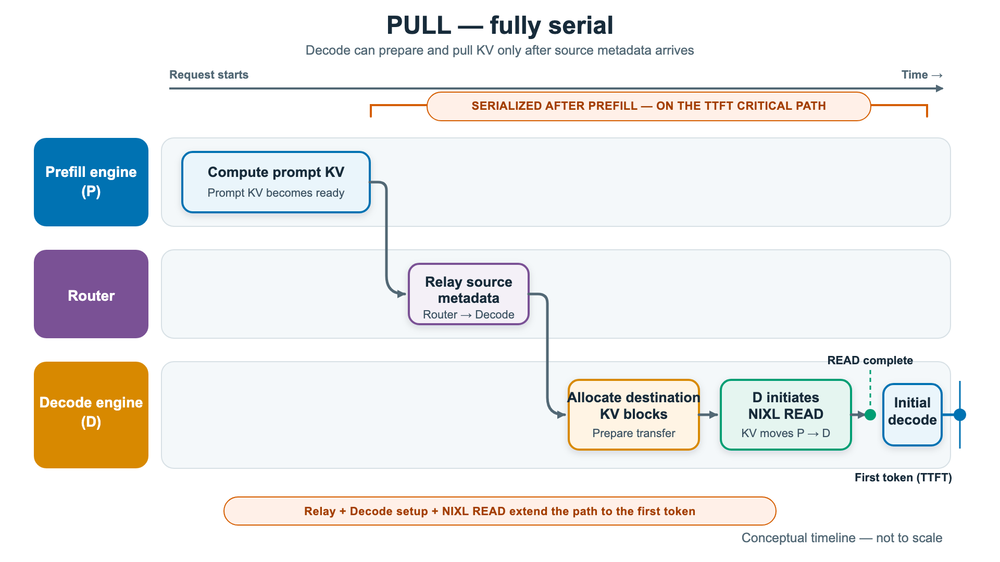
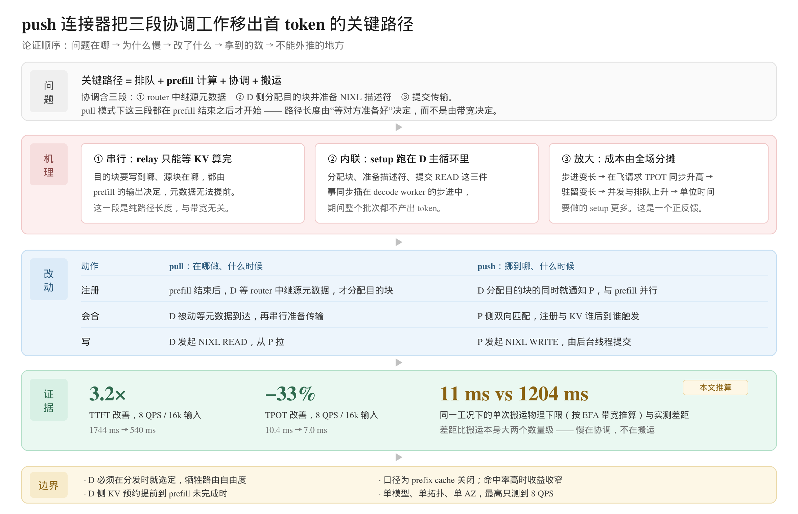
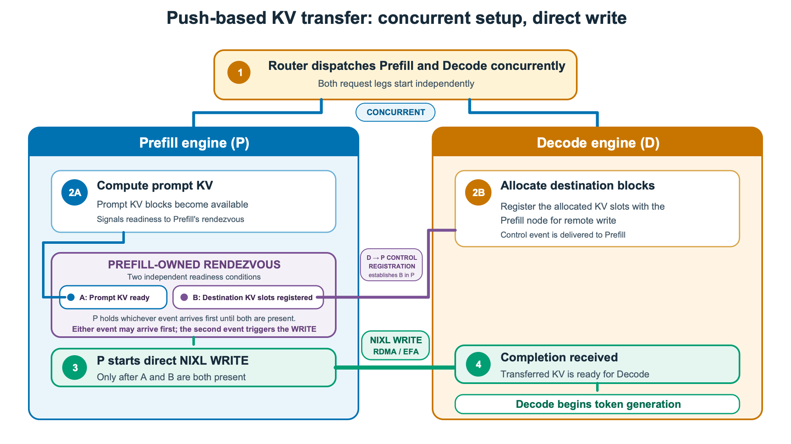
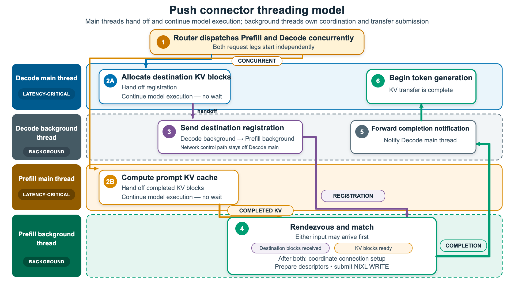
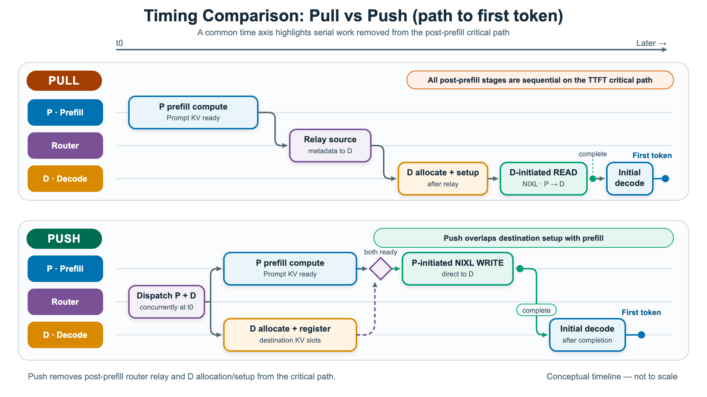
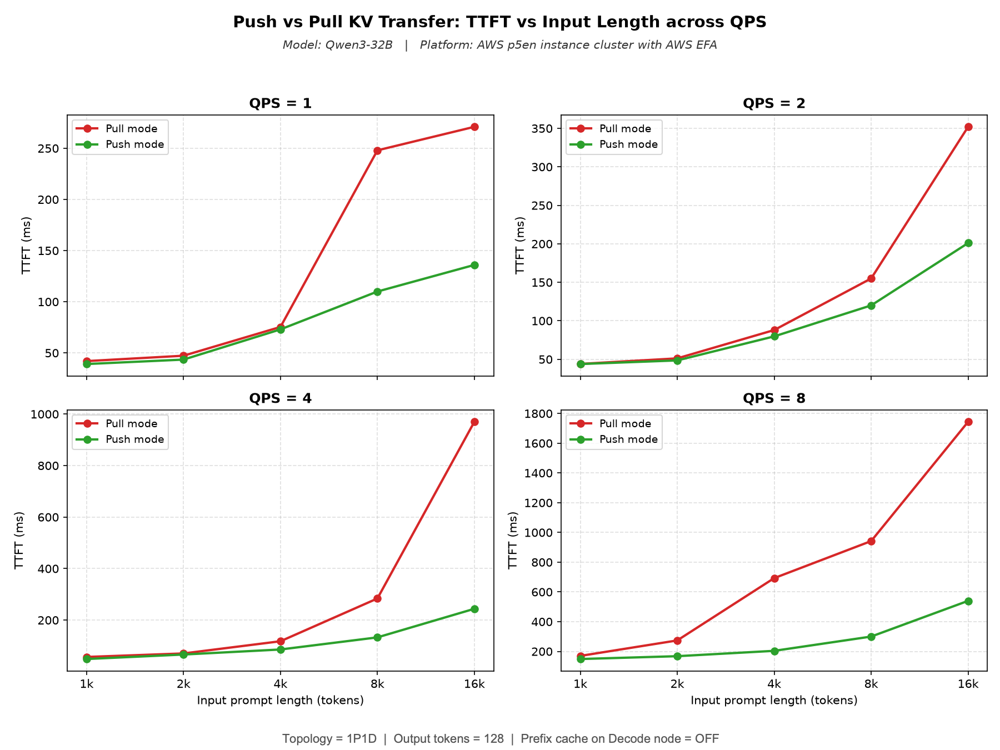
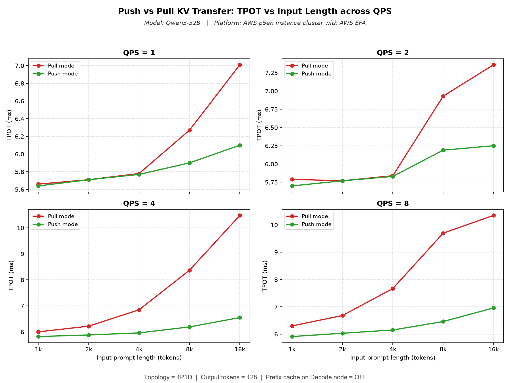

# vLLM NIXL Push 连接器案例解析：P/D 分离后首 token 为什么仍然慢

> 原文：*Push-Based KV Transfer to Improve TTFT and TPOT for Disaggregated Inference in vLLM*，vLLM Blog，2026-10-14，作者 Sunita Nadampalli（AWS）与 Nicolò Lucchesi（Mistral），约 15 分钟读完。配套材料有两份：2026-09-28 发布的[设计文档](https://docs.vllm.ai/en/latest/design/nixl_kv_push_connector/)，把线程、队列、唤醒条件、请求匹配都写到了实现级；以及四个可直接跑的复现脚本。
>
> 原文回答的是"push 比 pull 快多少、快在哪"。本文在原文之外多做四件事：把 TTFT 拆成可逐项归因的几段；用 EFA 带宽和 Qwen3-32B 的 KV 体积推算出"搬运本身的物理下限"，据此判断收益到底该记在谁头上；把设计文档里的线程与队列细节接进来，说明为什么"把 READ 换成 WRITE"本身并不等于变快；逐点核对图与正文的数字口径，并指出原文没有测的部分。

---

## 0. 一眼看懂

| 维度       | 结论                                                                                                 |
| -------- | -------------------------------------------------------------------------------------------------- |
| 这篇文章在做什么 | 给 vLLM 的 NIXL KV 连接器加一个 push 模式：prefill 实例把 KV 主动写进 decode 实例预先注册好的显存，代替 decode 主动来拉               |
| 解决的具体问题  | P/D 分离下，pull 模式的"取源元数据 → 分配目的块 → 准备描述符 → 提交 READ"四步全串在 prefill 之后，都压在首 token 的关键路径上                |
| 测量的负载    | Qwen3-32B，1P1D，输入 1k–16k，请求速率 1–8 QPS，输出固定 128 token，decode 侧关闭 prefix cache                       |
| 模型与硬件    | 两台 EC2 p5en.48xlarge（各 8×H200），EFA 16 网卡 ×200 Gb/s（节点合计 3.2 Tb/s），同 AZ，TP=8                        |
| 比较对象与条件  | NixlConnector（pull，默认）对比 NixlPushConnector（push），除 `kv_connector` 一个参数外完全同配置                       |
| 最强的一组数字  | 8 QPS / 16k 输入：TTFT 1744 → 540 ms（3.2×），TPOT 10.4 → 7.0 ms（约 −33%）                                 |
| 收益从哪来    | 不是搬得更快（两条路走同一条 NIXL/EFA 数据面），而是把三段协调工作分别前移、并行化、搬进后台线程                                              |
| 代价       | decode 实例必须在分发时就选定，失去"prefill 完成后再按实时负载选 D"的自由；D 侧 KV 块预约提前到 prefill 未完成时                          |
| 最值得带走的三条 | ① 先算搬运的物理下限，剩下的差值再谈归因；② 主循环里的串行段由全场在飞请求分摊，这是 TPOT 也会动的唯一解释；③ 低负载下两模式几乎相同，说明优化对象是"每秒要做的协调次数"，不是单次耗时 |
| 最稀缺的部分   | 设计文档把队列、唤醒条件、请求 id 匹配、握手重放都写清楚了 —— 这类连接器级实现细节通常只存在于代码里                                             |
| 一句话      | 首 token 慢，往往不是数据搬得慢，而是你在等对方准备好                                                                     |

---

## 1. 背景：P/D 分离把 TTFT 拆成两段，也把一次搬运塞进关键路径

### 1.1 为什么分离之后一定要搬一次

prefill 与 decode 的资源画像几乎相反：prefill 是一两次大 GEMM，算力密集；decode 是逐 token 的小计算，访存密集、受 KV 体积约束。挤在同一个实例里，两类负载互抢资源 —— 一条长 prompt 进来就能把整批 decode 的 TPOT 顶上去。P/D 分离让两边各自独立扩缩，代价是 prefill 算出的 KV 必须以某种方式交到 decode 手里。

这一步在数学上没有替代品：decode 的第一个 token 依赖完整 prompt 的 KV。所以只要分离，首 token 的延迟就变成了

$$
T_{\text{TTFT}} = T_{\text{queue}} + T_{\text{prefill}} + T_{\text{coord}} + T_{\text{transfer}}
$$

其中 $T_{\text{coord}}$ 是"把两边对齐"的开销。原文的全部工作，本质就是在压 $T_{\text{coord}}$，并且不让它污染 $T_{\text{transfer}}$ 之后那段 decode 步进。

### 1.2 pull 模式的默认路径

vLLM 默认的 NixlConnector 是 pull 语义：prefill 算完 → router 把源元数据（含 prefill 端的 block id）中继给 decode → decode 分配目的块、准备 NIXL 描述符 → decode 发 NIXL READ 从 prefill 拉。四步严格顺序。

图1 里用橙色框标出了这个被串行化的区间，框的宽度就是本文的优化对象。注意框内四步中，只有最后一小段是真的在搬数据 —— 前三步是纯粹的协调。

### 1.3 先算一个数：这次搬运的物理下限

先算清"搬一次到底要多久"。没有这个地板，后面所有收益数字都没法归因。

Qwen3-32B 的公开 config 给出：64 层、64 个 Q 头、8 个 KV 头（GQA）、head_dim 128、bf16。于是每 token 的 KV 体积

$$
\mathrm{KV}_{\text{token}} = 2 \times 64 \times 8 \times 128 \times 2\ \mathrm{B} = 256\ \mathrm{KiB}
$$

16k prompt 的单请求 KV 就是 16384 乘 256 KiB，约 **4 GiB**。TP=8 时每卡分到 512 MiB。

按原文描述的 EFA 拓扑：每台 p5en 有 16 张 200 Gb/s 网卡，每张卡与其中 2 张共享同一个 PCIe switch，NIXL 默认只在这 2 条 rail 上注册该卡的 KV（保证传输始终 PCIe-local）。所以单卡可用单向带宽是 400 Gb/s，即 50 GB/s。于是

$$
T_{\text{transfer}}^{\min} \approx \frac{512\ \mathrm{MiB}}{50\ \mathrm{GB/s}} \approx 10.7\ \mathrm{ms}
$$

这是按满带宽、零开销估的地板，实际还要加 NIXL 提交、完成通知、block 对不齐带来的零头。

顺手也算一下这个负载离带宽墙有多远，见表1。

| 输入长度 | KV 体积 / 请求 | 每卡分片（TP=8） | 线速时间下限  | 8 QPS 下带宽占用 | 占节点 3.2 Tb/s |
| ---- | ---------- | ---------- | ------- | ----------- | ------------ |
| 1k   | 256 MiB    | 32 MiB     | 0.67 ms | 17 Gb/s     | 0.5%         |
| 4k   | 1 GiB      | 128 MiB    | 2.7 ms  | 69 Gb/s     | 2.2%         |
| 8k   | 2 GiB      | 256 MiB    | 5.4 ms  | 137 Gb/s    | 4.3%         |
| 16k  | 4 GiB      | 512 MiB    | 10.7 ms | 274 Gb/s    | 8.6%         |

表1 的最后一列是本文最重要的一个前置结论：即便在最高负载点，链路的利用率也不到 9%。所以这是一个**控制面问题，不是数据面问题**。这一点几乎决定了后面所有设计的形状 —— 任何"换个更快的传输库"的思路都不会有数量级的收益。

---

## 2. 论证地图

图2 把全文的推理链压成一页：问题是什么、慢在哪三处、分别改了什么、拿到什么数、哪里不能外推。

读这张图时建议抓三条：中间那行"改动"表才是真正发生的事（注册提前、会合对等、写由生产者发起），READ 换 WRITE 只是它的表面；下面"证据"里那个 11 ms 对 1204 ms 的对比，是全篇归因的支点；最下面"边界"决定了这套结论能复制到多大的范围内。后面各节按这张图的顺序展开。

---

## 3. push 模式改了什么：把"注册"这一步倒过来

### 3.1 架构

push 的前提是 router 不再串行下发两条腿，而是一次把 prefill 腿和 decode 腿同时发出去（图3 最上面的 1 号框）。因为 decode 实例在分发时就已经确定，它才能在 prefill 还在算的时候，就把"我要写到哪"告诉 prefill。

这里有一个容易被跳过的因果链：**早选 D 是早注册的前提，早注册是传输能重叠的前提。** 全部收益都挂在这根链条上，全部代价也挂在它的第一环（见第 8 节）。

### 3.2 三步协议

原文把协议拆成注册 / 会合 / 传输三步，设计文档给出了实现级的落点，见表2。

| 步骤  | 谁发起 | 传什么                                                                                     | 什么时候                         | 实现落点                                                                   |
| --- | --- | --------------------------------------------------------------------------------------- | ---------------------------- | ---------------------------------------------------------------------- |
| 注册  | D   | `PUSH_REG` 加 msgpack 负载：request_id、D 的引擎 id 与 NIXL 坐标、D 的 TP 大小、D 已分配的逻辑 block id、P 的坐标 | D 分配目的块的那一步，与 P 的 prefill 并行 | `meta.push_registrations` → `_reg_send_inbox` → writer 线程 `send_notif` |
| 会合  | P   | 无数据，纯匹配                                                                                 | 注册与 prefill 完成块两者都到齐         | `_pending_d_registrations` 与 `_push_finished_blocks` 双向查表              |
| 传输  | P   | KV 数据（NIXL WRITE）                                                                       | 会合成立后立即                      | `_ensure_handshake` → `make_prepped_xfer` 加 `transfer`，完成后发通知          |

表2 里三处细节，我认为比"READ 换 WRITE"这个表面改动更值得记：

**一、block id 是逻辑的，写到一半才展开成物理的。** D 在注册里只发逻辑 block id，P 在提交 WRITE 时用握手期学到的 `remote_physical_blocks_per_logical` 换算成自己的物理地址。这条设计与 pull 模式的既有约定一致（调度器发逻辑 id、worker 在提交时展开），顺带带来一个实用能力：**两侧可以用不同的 block size**，P 和 D 的 PagedAttention 配置不必对齐。这是连接器这一层最容易被忽略的复用价值 —— 分离部署里两边往往是不同批次启动、参数不完全一致的。

**二、会合是靠 request_id 匹配，不是靠连接。** 两个方向都可能先到（注册先到就挂起等块，块先到就挂起等注册），谁第二个到谁触发 WRITE。匹配先试精确的 request_id，失败再剥掉每引擎追加的 8 位十六进制随机后缀，用 `get_base_request_id` 重试。这个 fallback 的必要性很实在：proxy 给两条腿的 `X-Request-Id` 是同一个，但两个引擎各自会包装成 `cmpl-<uuid>-<index>` 再加随机后缀。它同时兼容了被抢占或被重试而重新下发的请求 —— 这也是原文那句"matching accounts for reissued requests"的具体所指。

**三、握手不在后台线程里做。** 因为 `send_notif` 和 WRITE 都只能在 writer 线程上执行，握手被丢到 executor 上异步做；完成后不直接发，而是把操作重新入队（`_reg_send_inbox` 或 `_deferred_push_inbox`）再唤醒 writer，第二次进来时 agent 已连上，直接发。设计文档特意强调"两次握手都跑在 executor 上，永不阻塞 writer"，以及"握手失败就丢弃请求、不重试，因此没有重试循环"。

### 3.3 一次 WRITE 之后，D 怎么知道"到齐了"

每个 producer rank 各发一条完成通知，D 统计"期望的 rank 数"与"实际收到的通知数"，齐了才让请求进 decode。

这个设计的直接后果是：D 侧不需要额外的同步屏障，它只在 `get_finished` 里数数。代价是它必须知道期望值 —— 所以注册里要带 `remote_tp_size` 与 `decode_tp_size`。反过来看 pull 模式：D 自己发起 READ，自己知道提交了几个，数数更自然。**换成 push 之后，"谁负责知道全局"这件事跟着反转了**，这是协议倒置的隐性成本。

---

## 4. 线程模型：真正被挪走的是哪一段

### 4.1 两个主循环加两个后台线程

图4 里深色的是两个 latency-critical 主线程（D main、P main），虚线框里的是后台线程。整张图最该看的是 2A 和 2B 两个框下面的那行小字：**"Hand off registration. Continue model execution — no wait."**

这就是 push 的全部含义 —— 主循环只做一次入队，然后立刻回去算。

### 4.2 一条 push 请求的完整时间线

| 步骤                  | 执行者                    | 经过的队列 / 状态                                                     | 是否阻塞主循环     |
| ------------------- | ---------------------- | -------------------------------------------------------------- | ----------- |
| D 分配目的块、暂存注册、挂看门狗   | D scheduler            | `_push_pending_registrations` 与 `_push_registration_deadlines` | 否，调度器内联，微秒级 |
| D 主线程把注册交给 writer   | D worker main → writer | `_reg_send_inbox`                                              | 否，入队即返回     |
| D writer 发注册通知      | D writer               | NIXL `send_notif`                                              | 不涉及，已是后台    |
| P 侧暂存 prefill 完成块   | P scheduler            | `_finished_request_blocks` 与 `_newly_finished_push_blocks`     | 否           |
| P 主线程把块交给 writer    | P worker main → writer | `_finished_blocks_inbox`                                       | 否，入队即返回     |
| P writer 会合并发 WRITE | P writer               | 两张匹配表                                                          | 否           |
| D 数完成通知             | D worker main          | `_pending_completion_notifs`                                   | 是，但只做计数     |

三点关于唤醒模型的补充，能看出这个实现没有走"后台线程空转轮询"的懒办法：

- writer 没有活时阻塞在一个 `threading.Event` 上，唤醒源只有三个：`start_load_kv`（有新传输时才设）、`get_finished`（每步都设，好让 writer 有机会排空入站通知）、握手完成回调（把延后的操作重新入队后设）。
- 唯一会自己轮询的场景是"P 侧有完成块、但等不到匹配的注册"，此时以 1 ms 间隔自轮询（设计文档里是 `_PUSH_WRITER_POLL_INTERVAL_MS = 1.0`）。也就是说，最坏情况会给 P 侧关键路径加上最多 1 ms 的抖动。
- `has_pending_push_work` 会在存在在飞 push 状态时让引擎主循环继续步进，保证 writer 每个 step 至少有一次被唤醒的机会。代价是引擎在这段时间不会完全睡下去。

### 4.3 为什么 TPOT 也会变 —— 全文最容易被误读的地方

TPOT 是逐 token 指标，而一次 KV 传输是每请求一次的。直觉上"一次性开销只该影响 TTFT"，但原文的 TPOT 图确实动了，而且动得不小。

机理只有一条：pull 模式下，描述符准备和 READ 提交是**同步内联在 decode worker 的引擎步进里**的。decode 引擎是连续批处理，一个步进要推进所有在飞请求的 token。这段 setup 一旦插进步进，停顿的是整批，而不只是那个正等 KV 的请求。原文的措辞很克制："the decode instance does not spend those cycles during its latency-critical token-generation phase"。

反过来推：如果 push 只把 READ 换成 WRITE，而 setup 仍留在主循环里，TPOT 不会有这个变化。这也是原作者为什么把"后台线程"和"push 模式"绑在一起发布 —— 它们不是两件事，是一件事的两半。

这一条可以直接升格成排查经验：**主循环里的任何一段串行工作，成本由所有在飞请求分摊。** 看到 TPOT 随并发恶化而 TTFT 相对平稳时，第一件事该去找主循环里被内联的"每请求一次"的操作，而不是去怀疑网络。

---

## 5. 关键路径账：差的那 1.2 秒到底是谁

### 5.1 把两条路径写成式子

pull 是逐项相加：

$$
T_{\text{TTFT}}^{\text{pull}} = T_{\text{queue}} + T_{\text{prefill}} + T_{\text{relay}} + T_{\text{alloc}} + T_{\text{desc}} + T_{\text{xfer}}
$$

push 是两项取 max：

$$
T_{\text{TTFT}}^{\text{push}} = T_{\text{queue}} + \max\left(T_{\text{prefill}},\ T_{\text{alloc}} + T_{\text{reg}}\right) + T_{\text{xfer}}
$$

三处结构性差别：

1. 求和变取 max —— 分配与注册被塞进 prefill 的影子里；
2. relay 项整个消失 —— 因为 D 在分发时就已经知道 P 是谁，目录信息在 proxy 手里，不需要再走一次中继；
3. desc 加提交从"D 的主循环"移到"P 的后台线程" —— 这一项同时压低了 $T_{\text{queue}}$，因为它不再占用 D 的步进时间。

图5 把两条路径放在同一条时间轴上，可以直接看出被删掉的是哪一段。

### 5.2 用第 1.3 节的数做归因

取最优点 8 QPS / 16k 输入，把数字并排放，见表3。

| 量            | 值         | 来源                     |
| ------------ | --------- | ---------------------- |
| 单次搬运的线速下限    | 约 10.7 ms | 本文按 KV 体积除以单卡 EFA 带宽推算 |
| push 实测 TTFT | 540 ms    | 图6                     |
| pull 实测 TTFT | 1744 ms   | 图6                     |
| 两模式差距        | 1204 ms   | 相减                     |
| 差距 ÷ 搬运下限    | 约 113 倍   | 相除                     |

结论很硬：**同样的数据量、同一条 NIXL/EFA 数据面，pull 比 push 多花的时间是搬运本身的百倍量级。** 所以收益不可能来自"写比读快"。

那这 1204 ms 里是什么？定性上可以拆成两部分，而且它们互相放大：

1. **本请求自己的串行等待** —— relay、分配、描述符准备三项都在关键路径上，且随输入长度增长（16k 在默认 block size 下是上千个 block 要映射合并）。
2. **队列被污染后多出来的等待** —— setup 内联在 D 的步进里，D 的有效步进速率下降，同一 QPS 下排队就更长。而 $T_{\text{queue}}$ 这一项正是被 push 间接压下去的。

这两部分的比例，原文没有给，本文也无法从已有数据里拆开（没有逐项 profiling，没有关闭背景线程的对照组）。所以这里只能定性：**第一项解释"低负载下也有 2 倍差距"，第二项解释"高负载下差距会突然放大"。**

---

## 6. 实测：曲线形状本身就是证据

实验口径见表4。原文刻意关掉 decode 侧的 prefix cache —— 否则重叠 prompt 会命中 decode 本地缓存、直接绕过传输，把对比做成假象。

| 项    | 值                                                          |
| ---- | ---------------------------------------------------------- |
| 模型   | Qwen3-32B，bf16，TP=8                                        |
| 拓扑   | 1P1D，各 1 台 p5en.48xlarge（8×H200），同 AZ，无 placement group    |
| 网络   | EFA 16 张 ×200 Gb/s，installer 1.50.0，libfabric 2.6.0amzn1.0 |
| 服务参数 | `max-model-len 32768`，`max-num-seqs 8`，P 在 8100、D 在 8200   |
| 负载   | 输入 1k–16k，QPS 1–8，输出固定 128 token                           |
| 关键开关 | decode 侧 `--no-enable-prefix-caching`                      |
| 版本   | vllm 0.29.0，nixl 1.4.1                                     |

### 6.1 TTFT

图6 的四个面板是四档 QPS，横轴输入长度。按图读数（目测，误差约 ±5%）整理成表5。

| QPS | 输入  | pull (ms) | push (ms) | 比值   | 绝对差 (ms) |
| --- | --- | --------- | --------- | ---- | -------- |
| 1   | 1k  | 42        | 40        | 1.05 | 2        |
| 1   | 4k  | 72        | 70        | 1.03 | 2        |
| 1   | 16k | 270       | 135       | 2.0  | 135      |
| 2   | 16k | 355       | 200       | 1.8  | 155      |
| 4   | 4k  | 105       | 85        | 1.24 | 20       |
| 4   | 16k | 980       | 240       | 4.1  | 740      |
| 8   | 1k  | 190       | 160       | 1.19 | 30       |
| 8   | 4k  | 700       | 200       | 3.5  | 500      |
| 8   | 8k  | 940       | 300       | 3.1  | 640      |
| 8   | 16k | 1744      | 540       | 3.2  | 1204     |

曲线的形状比端点更值得看：16k 输入上，push 的四个点是 135、200、240、540 ms，随 QPS 温和上升；pull 的同一组点是 270、355、980、1744 ms，在 4k 输入之后就开始明显上翘。这不是"某一步变慢了"，而是"某个正反馈被点燃了" —— 与第 4.3 节的机理一致。

### 6.2 TPOT

图7 是同一工况下的 TPOT，形状与 TTFT 同源，但读数值得单独看一遍。

| QPS | 输入  | pull (ms) | push (ms) | 变化   |
| --- | --- | --------- | --------- | ---- |
| 1   | 1k  | 5.66      | 5.65      | 持平   |
| 1   | 16k | 7.02      | 6.08      | −13% |
| 2   | 16k | 7.36      | 6.25      | −15% |
| 4   | 16k | 10.42     | 6.52      | −37% |
| 8   | 8k  | 9.68      | 6.45      | −33% |
| 8   | 16k | 10.36     | 6.96      | −33% |

push 的 TPOT 在整张图上几乎是平的（5.6 ms 到 7.0 ms），pull 在 4–8 QPS 的长输入段从 6 ms 爬到 10.4 ms。原文的说法是"per-token latency stays flat even at high concurrency and long contexts" —— 图确实支持这个描述，而且它比"降低了 33%"更有信息量：**平线意味着这批开销被彻底移出了步进，而不是被摊薄了。**

### 6.3 交叉验算与一处口径不一致

- **3.2× 对得上。** 1744 除以 540 得 3.23，原文写"up to 3x"，是保守取整。
- **TPOT 的 30% 与图不一致。** 原文正文写"up to 30% better TPOT"，但图端点在 4 QPS 与 8 QPS 的 16k 上分别是 −37% 与 −33%。图比正文更激进。引用时建议直接用图端点，并注明是目测读数。
- **线速下限与实测差距对得上量级。** 10.7 ms 对 1204 ms，两个数量级的差距，不会因为 KV 精度或 rail 数的假设偏差而翻转。

---

## 7. 横向对比：五条可选路线的边界

把原文提到与没提的可选做法放进同一张表，见表6。这张表是全篇复用价值最高的一页。

| 做法                      | 关键机制                    | 高负载长输入的 TTFT | 高负载长输入的 TPOT        | 路由自由度             | 改动量                    | 适用场景                    |
| ----------------------- | ----------------------- | ------------ | ------------------- | ----------------- | ---------------------- | ----------------------- |
| 不分离（同实例）                | 没有传输，也没有 D 侧协调          | 无此项开销        | 长 prompt 会挤占 decode | 不涉及               | 0                      | 请求长度分布均匀                |
| pull（默认 NixlConnector）  | D 发起 READ，setup 内联在主循环  | 1744 ms      | 10.4 ms             | 最高，prefill 后仍可选 D | 0                      | 需要双向 KV 传输，或要按 D 实时负载选路 |
| push（NixlPushConnector） | D 预注册，P 发起 WRITE，后台线程提交 | 540 ms       | 7.0 ms              | 低，分发时定 D          | 三个子类加每 rank 一个线程加一种新通知 | 能接受早选 D，且 TTFT 优先       |
| pull 加后台线程（PR #45211）   | 只搬线程模型，不改传输方向           | 未知           | 未知                  | 最高                | 小                      | 待验证                     |
| 开 prefix cache          | 减少搬运量与 setup 次数         | 取决于命中率       | 不改变机理               | 与上面几行正交           | 0                      | 生产常态，但会掩盖 P/D 传输的真实代价   |

第 4 行是整篇最值得盯的一行 —— 它其实是一个机制拆分的对照实验。如果它能拿回大部分收益，说明"**移出主循环**"是主因、"**去掉 relay 往返**"是次因；如果只拿回一半，说明两者都要。原文把这条路写成 future work，我认为这是全篇最诚实的一处：它等于承认"我们还没有把两个机制的贡献分开"。

选型上原文的结论很干脆：能接受早选 D 且 TTFT 优先就上 push；需要双向 KV 传输、或要把 decode 实例的选择推迟到 prefill 之后做负载感知路由，就留 pull。两者在 vLLM 里共存，靠 `kv_connector` 一个参数切换。

---

## 8. 代价与反例

### 8.1 被放弃的三样东西

**路由自由度。** pull 允许 prefill 完成后按 D 的实时负载挑一个，push 必须在分发时定。这不只是"少了一个选项"，而是把负载均衡从"事后精确"降级成"事前预测"—— 一旦 D 的负载估计不准，push 会在错误的实例上排队，而它省下的那点协调时间未必补得回来。

**D 侧 KV 占用的时机。** push 要求 D 在 prefill 还没完成时就占住目的块。稳态总量不变（同一批请求迟早都要占），但**占用窗口变长了**：prefill 越慢、或注册过期（设计文档里有 `_push_registration_deadlines` 看门狗负责丢弃过期项并告警），这部分提前吃掉的显存就空转得越久。按本配置满配 8 并发 × 16k 估，同时在飞的 KV 约 8 × 4 GiB，即 32 GiB（本文推算）；在 pull 模式下，这部分要等 prefill 结束才计入 D 的显存账。

**引擎彻底空载休眠的机会。** `has_pending_push_work` 会让主循环在有在飞 push 状态时继续步进。这个代价被限制在"有在飞状态"期间，量级很小，但它确实存在，而且原文没有量化。

### 8.2 五个反例

| 直觉                        | 实测                                     | 机理                              | 教训                      |
| ------------------------- | -------------------------------------- | ------------------------------- | ----------------------- |
| 首 token 慢是因为 KV 搬得慢       | 16k 请求线速搬运约 10.7 ms，两模式 TTFT 差 1204 ms | 两者走同一条 NIXL/EFA 数据面，差的是协调       | 先算物理下限，差值才有归因方向         |
| 把 READ 换成 WRITE 就快了       | 真正改的是三个动作的位置，加一个后台线程                   | 收益来自重叠与出主循环，不来自方向               | 看"谁在等谁"，而不是看"谁发起"       |
| TPOT 是逐 token 指标，与一次性传输无关 | 10.4 → 7.0 ms                          | setup 内联在 D 的引擎步进，停的是整批         | 主循环里的串行段由全场分摊           |
| 低负载下也该有明显收益               | 1 QPS / 1k：42 对 40 ms                  | 每秒只做 1 次 setup，摊到 1000 ms 里可以忽略 | 不要用空载或短 prompt 数据验收这类优化 |
| 关 prefix cache 只是为了公平比对   | 它同时把每请求的搬运量与 setup 次数顶到最大              | 命中率高时两项都下降                      | benchmark 的开关就是结论的适用范围  |

---

## 9. 局限与读图注意

**一是单点配置。** 1P1D、TP=8、8×H200、单 AZ、`max-num-seqs 8`、输出固定 128 token。没有 2P1D、没有多 AZ、没有更大 TP、没有变长输出。原文自己也说了"results vary by workload and configuration"，但没给任何敏感性分析。

**二是只测到 8 QPS / 16k。** 再往上，把 setup 从 D 挪到 P 之后，P 侧会不会成为新瓶颈？理论上这段跑在 P 的后台线程、不占 prefill 关键路径，但 P 的 CPU 与内存带宽余量是新的约束，原文没有讨论。

**三是只有均值，没有尾部。** 所有图都是一条均值线，没有 p99、没有重复次数、没有误差棒。对 SLA 而言尾部的改善往往比均值更值钱，而这里恰好无法判断 —— 尤其 push 引入了一个最坏 1 ms 的自轮询抖动，它对均值几乎无影响，对 p99 可能有影响。

**四是一处非单调。** 16k 输入上，pull 除以 push 的 TTFT 比值按 QPS 1→2→4→8 依次约为 2.0、1.8、4.1、3.2（本文按图读数）。它不是单调上升 —— QPS=2 的比值反而低于 QPS=1。这说明除 setup 成本之外还有第二个变量在动（大概率是 P 侧 prefill 排队在两个模式下的分布不同），原文没有解释。引用时不要把它简化成"负载越高收益越大"。

**五是口径。** prefix cache 关闭是必要设计，但它对应的是"每条请求都要全量搬 KV"的最坏工况。生产里命中率高时，搬运量和 setup 次数都会下降，收益会明显收窄。

**六是我的推算依赖三个假设。** KV 为 bf16、每卡只用与 PCIe switch 同侧的 2 条 rail、满带宽零开销。任一条不成立（比如实际压到 fp8、或 NIXL 用了更多 rail），10.7 ms 这个数会变，但量级不变 —— 第 5.2 节"差距是搬运的百倍量级"这个结论对上述误差不敏感。

---

## 10. 洞察

**一、首 token 的关键路径上，最贵的通常不是搬运，而是"等对方准备好"。**
1204 ms 的差距对应的是一次 10 ms 量级的搬运。这个比例关系不是 vLLM 特例 —— 只要一条路径上包含"取元数据、分配资源、准备描述符、提交传输"这类协调动作，且它们串行在数据生产之后，协调的时间就会数倍乃至上百倍于数据本身。排查时应该先量这一段，而不是先怀疑网络。

**二、判断有没有优化空间，第一步是算物理下限。**
先把"这件事物理上最快能做到多少"算出来（本轮是 3.2 Tb/s、每卡 50 GB/s、每 token 256 KiB，得出 10.7 ms），再看实测值。540 ms 的 push TTFT 里绝大部分也是 prefill 计算与排队，任何针对那 10.7 ms 的努力都不该优先。反过来，如果某个指标已经贴着物理下限，再去优化传输层就是无效工作。

**三、主循环里的串行段，成本由所有在飞请求分摊 —— 这是"后台线程"不是可选项的原因。**
TPOT 从 10.4 ms 改善到 7.0 ms，靠的不是把传输变快，而是把"每请求一次"的准备动作移出步进。这条判据可以当模板用：看到 TPOT 随并发恶化、TTFT 相对平稳，就去主循环里找被内联的每请求操作；看到两者一起恶化，才去找资源与排队。

**四、所有把协调移出关键路径的方案，本质都是"拿确定性换延迟"。**
push 用"提前决定 decode 实例"换取"提前注册目的块"。这类交换在系统里反复出现 —— 预取、预分配、预建连都是同一件事。能不能做成，取决于两个条件：有没有一个足够早的决策点，以及这个决策点的信息质量是否足以支撑提前决定。push 的代价（失去负载感知路由）恰好就是第二个条件不足的表现。

**五、把"两个机制还没拆开"写进 future work，比声称 3× 更有信息量。**
原文的 3× 是干净的工程结果，但 PR #45211 才是方法论上的自我检验：用同一份负载、只改线程模型，去看"重叠"和"出主循环"各自的贡献。这类对照实验在小规模优化里经常被跳过，而它恰恰决定了下一个项目该优先复制哪一半。

---

## 11. 原文资源

- 原文：[Push-Based KV Transfer to Improve TTFT and TPOT for Disaggregated Inference in vLLM](https://vllm.ai/blog/2026-10-14-nixl-push-connector)，vLLM Blog，2026-10-14，Sunita Nadampalli（AWS）、Nicolò Lucchesi（Mistral）
- 设计文档：[NIXL push-mode KV transfer](https://docs.vllm.ai/en/latest/design/nixl_kv_push_connector/)，2026-09-28，含线程、唤醒模型、线格式、调度器职责
- 背景文档：[vLLM disaggregated serving](https://docs.vllm.ai/en/latest/features/disagg_prefill.html)、[NIXL connector 使用说明](https://docs.vllm.ai/en/latest/features/nixl_connector_usage/)
- 复现脚本：`serve_pd.sh`（两种模式起 P/D 腿）、`run_sweep.sh`（压测扫描）、`cleanup.sh`（清理）、`plot_push_vs_pull.py`（重画两张性能图），随原文发布
- 基准代码：`vllm-project/vllm` PR #57567，含 `disagg_proxy_demo.py`（pull）与 `disagg_proxy_pushconnector_demo.py`（push），压测用 `vllm bench serve`
- 后续 PR：`vllm-project/vllm` PR #45211，把后台线程模型带回 pull 模式
- 开关与配置项：`kv_connector`（`NixlConnector` 或 `NixlPushConnector`）、`kv_role`、`kv_rank`、`kv_parallel_size`、`engine_id`、`kv_connector_extra_config.backends`；push 模式额外需要 `PREFILL_ENGINE_ID`、`PREFILL_KV_HOST`、`PREFILL_SIDE_CHANNEL_PORT`、`PREFILL_TP_SIZE`、`PREFILL_PP_SIZE`；benchmark 用 `--no-enable-prefix-caching` 隔离传输路径
- 环境：`vllm==0.29.0`、`nixl==1.4.1`、EFA installer `1.50.0`、libfabric `2.6.0amzn1.0`、EFA kernel module `3.3.0g`
